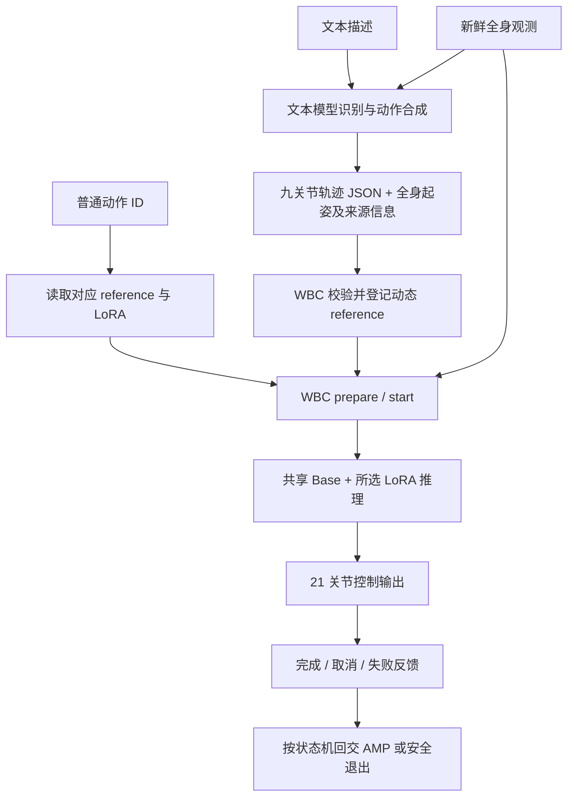

# L0 V5 运控部署：WBC + LoRA 与文本动作生成

更新：2026-11-09。当前版本同时提供 **RK3588 真机部署**与 **x86_64 MuJoCo 仿真**，包含匹配的接口源码、AMP 策略、WBC 动作资产、文本生成模型和运行配置。仓库根目录就是 ROS 工作区，部署时需同时保留 `src/`、`model_sources/` 和 `deploy_config/`。

当前真机工作区：`/userdata/forlinx/wbc_text_workspace1104`。日常部署、构建及测试以 [【final1104】真机 WBC 与文本生成启动测试](docs/【final1104】real-wbc-text-startup-testing.md) 为准。MuJoCo 按 [仿真组成与部署说明](docs/sim2mujoco-deployment.md) 和 [仿真测试记录](docs/sim2mujoco-testing.md) 操作。

## 1. 代码功能与四条入口

| 功能 | 启动入口（`legged_controllers`） | 运行资产 | 推理方式 |
| --- | --- | --- | --- |
| 真机普通 WBC 动作 | `wbc_lora.launch.py` | `wbc_lora_fp16`，默认预加载 **86 个动作** | 共享 Base RKNN + 每动作 LoRA + reference RKNN |
| 真机文本生成动作 | `text_wbc.launch.py` | 文本模型 + `text_wbc_bundle` | 文本 RKNNLite → 九关节 JSON → 共享 Base RKNN + `UpperBody_Enhanced` LoRA |
| MuJoCo 普通 WBC 动作 | `sim2mujoco.launch.py` | `wbc_lora_sim`，包含 **14 个固定动作** | 共享 Base ONNX + 每动作 LoRA + reference ONNX，OpenVINO CPU |
| MuJoCo 文本生成动作 | `sim2mujoco_text.launch.py` | 文本 ONNX + `text_wbc_sim` | ONNX Runtime CPU → 九关节 JSON → OpenVINO WBC + `UpperBody_Enhanced` LoRA |

四条入口默认采用 V5 机器人和 `l0_v5_amp_10281` AMP。普通 WBC 动作预加载不会自动执行或轮播。**MuJoCo 不使用 RKNN；真机和仿真使用独立资产包及构建目录。**

本代码还负责 AMP 行走、AMP/WBC 切换、手柄与动作指令接入、实时观测、硬件反馈检查、急停和动作结果反馈。实机通过既有 HPM 的 `robot_interfaces` 电机通信接口运行；HPM 程序按现场原流程独立启动。雷达、局部规划、云桥接及头部/序列辅助功能保留在相应模块，具体是否启用由 launch 配置决定。

## 2. 部署组成与目录

以下目录均相对于仓库／工作区根目录：

```text
l0_deploy_v5_ws/
├── src/
│   ├── l0_ros2_deploy_v2/
│   │   ├── legged_controllers/       状态机、策略切换、launch 与操作入口
│   │   ├── legged_deploy/            AMP/WBC 推理、LoRA 参数和 JSON reference
│   │   │   └── policy/l0_v5/
│   │   │       ├── l0_v5_amp_10281/  AMP ONNX、RKNN、关节和手柄配置
│   │   │       ├── wbc_lora_fp16/    真机 86 个普通动作
│   │   │       ├── text_wbc_bundle/  真机文本 WBC，仅 UpperBody_Enhanced
│   │   │       ├── wbc_lora_sim/     MuJoCo 14 个普通测试动作
│   │   │       └── text_wbc_sim/     MuJoCo 文本 WBC
│   │   ├── texttomotion/            文本生成、关节适配和 JSON 接入
│   │   │   └── baseline/onnx/       文本 ONNX、词表、素材和动作合成实现
│   │   ├── legged_env_real/         真机硬件桥接、反馈和保护
│   │   ├── legged_env_mujoco/       MuJoCo 模拟器与桥接
│   │   ├── legged_description/      V5 MJCF/URDF 与网格等机器人资源
│   │   ├── system_command_arbiter/  电机映射、关节限位与公共转换
│   │   ├── robot_interfaces/        匹配的 HPM 接口定义
│   │   ├── scripts/                 导出、转换、校验、启动和录包工具
│   │   └── docs/                    真机与仿真使用、测试和架构说明
│   ├── luvbot_ros_interfaces/       匹配的策略、控制等 ROS 接口
│   └── odin_ros_driver_rev1/        雷达驱动源码
├── model_sources/text_to_motion/
│   ├── compiled/                   文本 RKNN、manifest、词表和素材
│   ├── deps/rknnlite/               板端 RKNNLite2 2.3.2
│   └── runtime/librknnrt.so         文本推理专用 Runtime 2.3.2
├── deploy_config/
│   ├── wbc-production.env          V5、AMP、WBC 包和 86 动作选择
│   └── wbc-record-qos.yaml          录包 QoS
├── PACKAGE_INFO.json               20261102 文本模型补充包原始来源记录
├── TEXT_MODELS_SHA256SUMS           文本交付文件校验清单
└── 文本模型放置说明.txt
```

`PACKAGE_INFO.json` 描述的是原始文本补充包，不是当前完整仓库的文件清单；其中历史源码哈希不代表后续所有代码修改。当前文本交付文件通过 `TEXT_MODELS_SHA256SUMS` 校验，真机 WBC 资产通过各包的 `INSTALLATION.json` 校验。

### 2.1 普通 WBC 的 86 个动作

完整运行包在 `src/l0_ros2_deploy_v2/legged_deploy/policy/l0_v5/wbc_lora_fp16/`：

```text
wbc_lora_fp16/
├── base_lora.rknn                  一个共享 WBC Base
├── base_lora.rknn.json             Base 转换记录及清单关联
├── base_manifest.json             86 个动作、配置和参数包索引
├── INSTALLATION.json              运行资产 SHA256 清单
├── actions/<动作ID>/
│   ├── reference_motion.rknn       该动作的参考轨迹
│   ├── reference_motion.rknn.json  转换来源和哈希
│   └── rl_config.yaml             帧数、频率、关节等配置
└── adapters/<动作ID>/
    ├── weights.bin                该动作所用的 LoRA 参数包
    └── manifest.json              参数结构及哈希
```

每个动作使用清单中对应的 reference 和 adapter；目录独立不等于权重一定互不相同。不要将它理解为 86 份各自独立的 Base policy。

本版保留了四个新动作 `L0_strange_new_1_A`、`L0_strange_1`、`L0_excited_8`、`L0_angry_new_2` 的 LoRA/reference 更新。

2026-11-04 又仅裁剪了以下三个动作 reference 的首尾长静止段，各保留 **50 帧，按 50 Hz 计约 1 秒**。保留片段的六张参考数据表逐值不变，Base、LoRA 及其他动作未变：

| 动作 | 原总帧数 | 当前总帧数 | 当前首／尾静止帧 |
| --- | ---: | ---: | ---: |
| `L0_SayNo_17` | 704 | 272 | 各 50 帧 |
| `L0_sad_7` | 863 | 431 | 各 50 帧 |
| `L0_Approve_8` | 816 | 414 | 各 50 帧 |

三个配置中的 `start_hold_sec=1.0` 保持原值，这是控制器开头额外的保持时间，不包含在 reference 的 50 帧内。帧数及必要哈希元数据已随新 reference 更新。

### 2.2 文本模型与文本 WBC

- 文本推理入口：`legged_controllers/scripts/text_wbc_generate`。
- 生成脚本：`texttomotion/generate_wbc_json.py`；关节和限位适配在 `motion_adapter.py`。
- 真机文本模型：工作区根目录 `model_sources/text_to_motion/compiled/manifest.json`，包含 `qwen_tokenizer.rknn` 与 `inbetweener.rknn` 及配套资源。
- 仿真文本模型：`texttomotion/baseline/onnx/manifest.json`，使用对应 ONNX 模型。
- 真机执行包：`policy/l0_v5/text_wbc_bundle`，只保留 `UpperBody_Enhanced`，包含共享 Base RKNN、非零 LoRA、配置及基准 reference。
- 仿真执行包：`policy/l0_v5/text_wbc_sim`，使用 Base ONNX 和 `UpperBody_Enhanced` LoRA，仅用于动态 JSON 动作。

真机与仿真 `UpperBody_Enhanced` 参数包的来源不同，不能因动作名相同而交换文件。仿真 `A-C04_mod` 和仿真文本包使用用户指定的“稳定下半身，强化上半身”PT 所导出参数；具体来源记录在仿真包 `SIMULATION.json`。

### 2.3 MuJoCo 资产范围

普通仿真包交付 14 个动作。原有六个动作：`L0_strange_new_1_A`、`L0_strange_1`、`L0_excited_8`、`L0_angry_new_2`、`A-C04_mod`、`L0_crouch_off`。2026-11-09 新增的 `L0_crouch_off` 默认在终端触发并正常完成后进入 EmergencyStop，其余动作仍返回 AMP；名单由仿真参数 `wbc_emergency_after_actions` 配置，只在 MuJoCo 生效，详见仿真部署说明。2026-11-09 另补齐了下述 8 个手柄绑定动作的仿真资产。真机 86 动作齐全，不代表全部 86 个动作已经提供了 MuJoCo reference ONNX 或完成仿真测试。

V5 物理模型为 `legged_description/l0_v5_description/mjcf/l0_base_hip_collision_split_experimental.xml`，对应网格已随源码提供，运行不依赖原回收站路径。默认软关节限位时间常数为 `0.004`，详细模型差异和验证范围见仿真文档。

### 2.4 手柄与终端并用（2026-11-09）

普通 MuJoCo 和真机 WBC 入口默认启用独立 `joystick_wbc_request` 节点，终端控制继续保留。映射在 `legged_controllers/config/joystick_wbc_actions.yaml`：

| 方向 | LT | RT |
|---|---|---|
| 上 | `L0_fear_7_A` | `L0_satisfied_10` |
| 下 | `L0_excited_1` | `L0_SayNo_17` |
| 左 | `L0_excited_new_1` | `L0_angry_9` |
| 右 | `L0_excited_new_5` | `L0_angry_new_1` |

动作前需进入 AMP；启动、完成和断连恢复后先松开所有按钮与十字键再按。长按不连发，忙碌时不排队，最终由原控制器检查执行条件。文本生成入口关闭固定动作绑定。可用 `joystick_wbc_enabled:=false` 只保留终端控制。详见 [手柄使用与输入规则](docs/joystick-wbc-control.md)。2026-11-09 已完成 MuJoCo 等价 Joy 消息链路验证，并在 `192.168.120.41` 的 `/userdata/forlinx/wbc_text_workspace1104` 完成手柄代码更新、RKNN 后端 9 包编译及安装检查；实体手柄及真机动作已由用户完成现场验证。

加载对应真机或仿真环境后，选择相应入口：

```bash
# 真机：HPM、电机与站立准备按现场原流程处理
ros2 launch legged_controllers wbc_lora.launch.py hpm_mode:=real joystick_wbc_enabled:=true

# MuJoCo：使用仿真 install 环境
ros2 launch legged_controllers sim2mujoco.launch.py joystick_wbc_enabled:=true
```

手柄节点订阅既有 `/joy`，将组合键转换为 `/algorithm/brain/wbc_action_cmd` 请求；终端仍通过同一接口请求动作，控制器负责最终互斥和状态检查。八个绑定动作正常完成后均返回 AMP。真机终端请求和反馈查看的完整命令见 [手柄与终端操作流程](docs/joystick-wbc-control.md)。MuJoCo 仍可执行 `ros2 run legged_controllers mujoco_control action L0_excited_1`。

默认布局为 LT/RT 对应 `buttons[8]`/`buttons[9]`，十字键对应 `axes[6]`/`axes[7]`（左/上为正）。可通过 `joystick_wbc_config_path:=/绝对路径/配置.yaml` 指定映射；八个动作必须在当前预加载名单内。所有按钮与十字键需松开至少 0.15 秒才能重新触发；两只扳机同时按、十字键斜向或混入其他按钮时不请求动作。手柄消息中断超过 0.5 秒后取消触发准备，恢复时需重新松开再按。

## 3. 动作运行流程

2026-11-10 的 `fix/amp-wbc-handoff-20261110` 分支将 AMP/WBC 初始动作历史改为源策略目标
换算，并修复 AMP 初始化请求在跳帧时被提前消费的问题。默认 AMP→WBC 插值 1.0 秒、
WBC→AMP 插值 0.35 秒；`start_hold_sec` 仍只控制 reference 起始停留。该修改涉及控制
消息/服务，需要成套重新编译；`.23` 板端已编译，新交接逻辑的运行验收仍待进行。实现、参数及验收范围见
[AMP/WBC 交接初始化](docs/amp-wbc-handoff.md)。



文本模型生成的是上半身九关节轨迹：左臂三轴、右臂三轴、颈部 yaw/pitch/roll，频率为 50 Hz、角度单位 rad。生成器记录 21 关节起姿，WBC 接收端据此补齐全身 reference；下肢起姿不是文本模型额外预测出来的。

真机默认 `root_reference_source=wbc_base_action`，根部目标使用 `UpperBody_Enhanced` 基准 reference；MuJoCo 文本链路使用模拟器实时基座位姿。XML 初始 z=0.4575 m 不作为真机统一固定目标高度。

JSON 要通过来源、Base 身份、关节顺序、限位、起姿和时效检查。正式执行必须重新采集实时观测生成；离线测试 JSON 和过期 JSON 不能作为可重复播放的固定动作直接使用。

| 接口 | 用途 |
| --- | --- |
| `/control/policy/observation` | 21 关节与基座/IMU 实时观测 |
| `/algorithm/brain/wbc_action_cmd` | 动作 ID 与当前时间戳请求 |
| `/system/state_machine/wbc_action_fdb` | 动作 started/completed/rejected/failed 等反馈 |
| `/text_motion/json` | 文本生成的 JSON reference |
| `/text_motion/wbc_status` | 动态 reference 的登记状态 |
| `/text_motion/cancel` | 取消指定文本请求 |

AMP/WBC 的准备、接管、完成与交接由现有控制状态机处理。预加载数量不会增加同时执行的动作数量，动作期间不排队叠加其他动作。

## 4. 真机部署与启动

目标环境是 RK3588 Linux/aarch64、Ubuntu 22.04、ROS 2 Humble；文本入口使用 Python 3.10 和随工作区交付的 RKNNLite/Runtime。ROS 编译仍需板端已有的 C++、ROS、yaml、OpenSSL、mosquitto 等依赖。模型随源码提供，不表示 ROS 或 HPM 系统环境也已打包。

完整上传、干净环境构建、动作请求和文本生成命令见 [【final1104】真机测试文档](docs/【final1104】real-wbc-text-startup-testing.md)。构建从工作区根目录执行，关键选项为：

```text
--packages-up-to legged_real legged_deploy legged_controllers l0_v5_description
-DLEGGED_DEPLOY_BACKEND=RKNN
-DLEGGED_DEPLOY_WBC_SIM=OFF
```

构建后在真机新终端加载本工作区：

```bash
export ROBOT_WS=/userdata/forlinx/wbc_text_workspace1104
source /opt/ros/humble/setup.bash
source "$ROBOT_WS/install/setup.bash"
ros2 pkg prefix legged_deploy
```

包路径应指向当前工作区。准备现场 HPM 和手柄流程后，两种入口分开运行：

```bash
# 普通 WBC：默认预加载 86 个动作
ros2 launch legged_controllers wbc_lora.launch.py hpm_mode:=real
```

```bash
# 结束普通 WBC 控制会话后，单独启动文本 WBC
ros2 launch legged_controllers text_wbc.launch.py hpm_mode:=real
```

文本通过 `ros2 run legged_controllers text_wbc_generate` 生成和提交，按最终测试文档设置 model、bundle、mapping、文本和新的输出路径。可选运行记录脚本为 `scripts/start_sim2real.sh`，读取根目录 `deploy_config/wbc-production.env`；它还需要有效 Git 工作树以保存源码版本。直接 ROS 入口无需该运行记录步骤。

当前真机默认倾角设置为 roll 30°、pitch 360°、连续违规 10 个周期。pitch 计算范围为 ±90°，因此 360° 不触发该项 pitch 超限保护；这是现有部署配置，本 README 更新未改动保护逻辑。

## 5. MuJoCo 构建与测试

目标环境是 x86_64 Linux、ROS 2 Humble、OpenVINO C++ Runtime、MuJoCo/GLFW，以及与 ROS ABI 一致的 Python 3.10/ONNX Runtime。需用独立 build/install/log 目录，关键编译选项为：

```text
-DLEGGED_DEPLOY_BACKEND=OPENVINO
-DLEGGED_DEPLOY_WBC_SIM=ON
```

完成 [仿真部署文档](docs/sim2mujoco-deployment.md) 中的构建并 source 对应 install 后，分别使用：

```bash
# 普通 WBC 14 动作，含 LT/RT + 十字键 8 个绑定
ros2 launch legged_controllers sim2mujoco.launch.py
```

```bash
# 文本生成 WBC，另起一轮仿真
ros2 launch legged_controllers sim2mujoco_text.launch.py
```

仿真操作入口是 `ros2 run legged_controllers mujoco_control`，文本入口是 `text_mujoco_generate`。仿真默认 localhost 通信、ROS domain 77；各终端必须使用同一仿真 install。不要将此 domain 配置照搬到真机。

## 6. 资产校验与更新规则

在工作区根目录核对文本交付文件：

```bash
sha256sum -c TEXT_MODELS_SHA256SUMS
```

WBC 运行包的动作、配置、reference、LoRA 由 `base_manifest.json` 和 `INSTALLATION.json` 关联；单独替换文件而未更新相关哈希会使校验失败。更新 reference 帧数时必须同步 `rl_config.yaml` 的 `reference_num_frames`，但无需重新训练或替换 Base/LoRA。

WBC 正式运行从 `install/legged_deploy/share/legged_deploy/policy/l0_v5/` 加载资产；只改 `src/` 后执行 `source` 不会更新 install，需要重新构建安装。AMP 模型使用编译时嵌入的源码策略路径，因此必须保留源码资产；搬动工作区后重新构建，不能只复制旧 install。

项目交付应包含全部运行资产、匹配接口和机器人网格。设备私钥/证书、构建目录、运行日志、缓存和重复压缩包不属于版本库运行交付内容。

## 7. 已有验证与文档索引

- 2026-11-04：真机 `wbc_text_workspace1104` 的 9 个包编译成功；文本交付文件、安装资产与动态库检查通过。
- 同日：三条文本在板端 NPU 实际生成成功，分别为点头 65 帧、左手抬起 79 帧、组合动作 136 帧。此项是离线生成验证，不等同于所有文本动作的实机表现验收。
- 同日：上述三个裁剪后的 reference 已在板端转换、完成全部帧及越界钳制查询验证，六类输出与源数据一致；9 个包重新构建通过，真机 source/install 与本机运行包同步。此项没有启动机器人执行动作。
- 用户反馈按最终真机启动测试文档操作正常；具体现场动作覆盖和长期稳定性不由上述离线检查推断。
- MuJoCo 的历史测试使用过旧 XML；当前碰撞拆分模型的独立验证范围以原测试记录为准。

| 文档 | 用途 |
| --- | --- |
| [【final1104】真机 WBC 与文本生成启动测试](docs/【final1104】real-wbc-text-startup-testing.md) | 当前真机部署、编译、两轮测试和板端检查记录；优先使用 |
| [MuJoCo 组成与部署](docs/sim2mujoco-deployment.md) | 仿真模型、架构、资产、构建与操作 |
| [MuJoCo 测试记录](docs/sim2mujoco-testing.md) | 数值、动作生命周期和物理测试范围 |
| [LoRA 与文本生成架构](docs/lora-text-generation-architecture.md) | 源码与资产关系、两条链路解释 |
| [文本部署详细说明](docs/text-motion-deployment.md) | JSON 协议、取消、限位与故障排查 |
| [WBC 模型制作与部署手册](docs/wbc-lora-production-deployment.md) | 导出、RKNN 转换、安装、录包与工具使用 |
| [20261102 动作集成记录](docs/actions-20261102-deployment.md) | 四动作替换来源与资产追溯；其中旧默认值不作为当前启动依据 |
| [下载版历史手册](docs/wbc-lora-production-deployment-downloaded-20261103.md) | 原交付对照，保留旧路径和旧配置，不作为当前启动命令 |
| [HPM 关节映射说明](system_command_arbiter/README.md) | 实机电机和 V4/V5 映射 |
| [头部时间线说明](head_script_usage.md) | 可选头部脚本配置 |

最终真机测试文档与两份 MuJoCo 文档保持原内容。本文按当前源码与资产汇总，历史说明中的旧工作区、旧 AMP 或“两动作默认列表”应以当前入口配置和最终测试文档为准。
