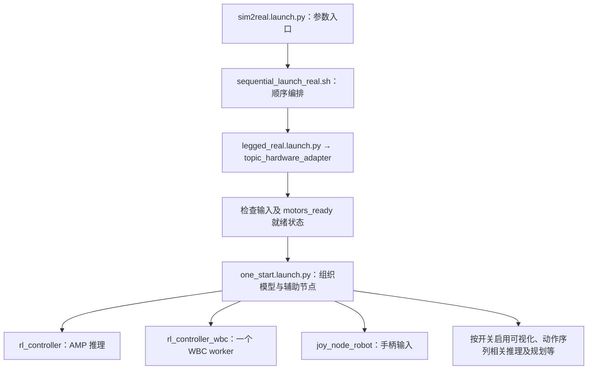
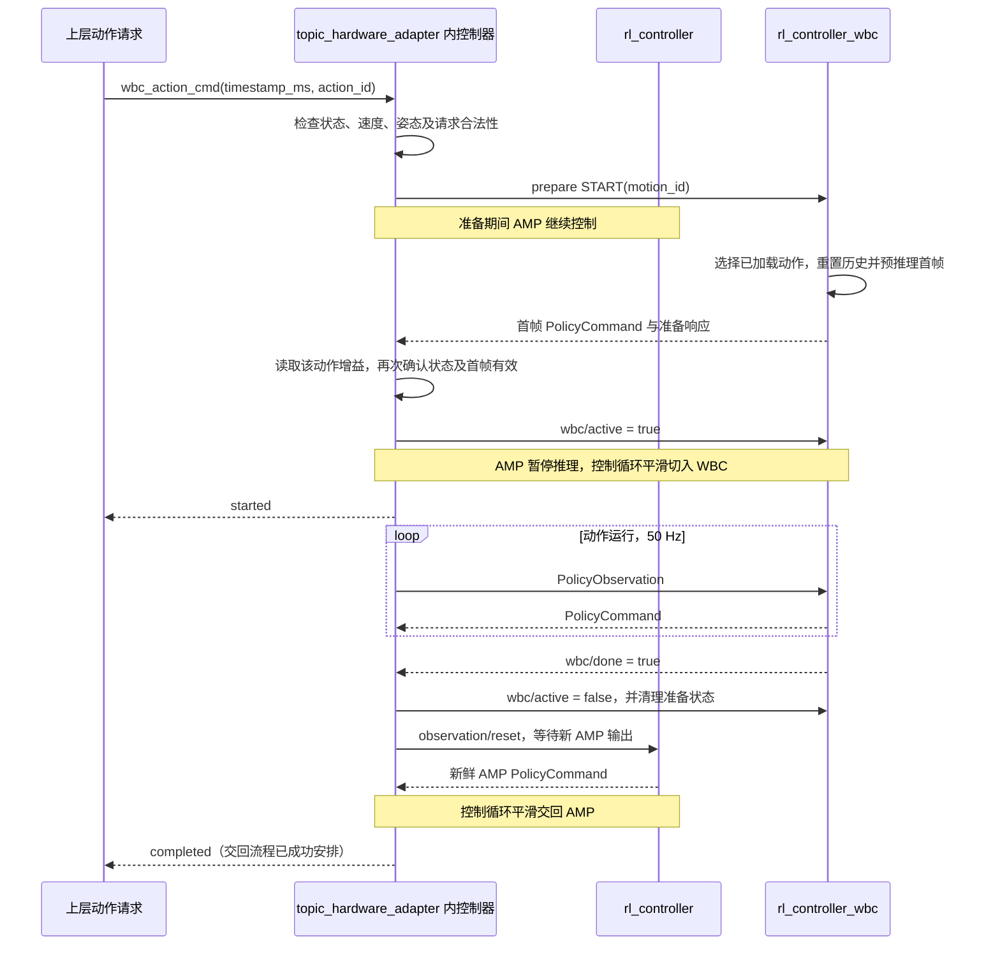

# 运控模型部署流程与 ROS 2 工作机制

归档日期：2026-10-26。来源：工作空间根目录的 `deploy_workflow`。

原有部署步骤保持原文和顺序，模型及节点说明沿用已核对内容；归档时仅调整补充说明中的代码链接以适应 `docs/` 位置。工作空间源文件保留。

本文记录现有的逐动作 policy/reference 预加载实现。共用 WBC 基础模型及动态 LoRA 属于后续改造，参见 [WBC-LoRA 部署方案](wbc-lora-deployment-plan.md)和[可行性审阅](wbc-lora-feasibility-review.md)。范围限定为运控模型及相关 ROS 2 节点，不包含底层节点启动操作。

---

1. 在src/l0_ros2_deploy_v2/legged_deploy/policy/l0_v3目录下放置对应的参数文件，每个动作对应的policy和referencemotion需要对应一个文件夹，包含policy.onnx referencemotion.onnx 以及rlconfig.yaml文件
2. 使用src/l0_ros2_deploy_v2/batch_convert_onnx_to_rknn_rk3588.py，脚本内部调用src/l0_ros2_deploy_v2/convert_onnx_to_rknn_rk3588_wbc_policy.py src/l0_ros2_deploy_v2/convert_onnx_to_rknn_rk3588_wbc_reference.py对l0_v3目录下的逐个onnx文件调用onnx2rknn转换并生成policy和referencemotion对应的rknn文件
3. 在src/l0_ros2_deploy_v2/legged_controllers/launch/sim2real.launch.py文件中修改加载rknn文件，在
DeclareLaunchArgument('wbc_policies', default_value='[L0_excited_1, L0_sad_1, L0_sad_7, L0_sad_8, L0_sad_9, L0_sad_10, L0_sad_new_1, L0_sad_new_2, L0_sad_new_3, L0_sad_new_4, L0_sad_wanyao, L0_14_satisfied, L0_Approve_8, L0_Approve_24, L0_Approve_26, L0_delicious, L0_satisfied_7, L0_satisfied_8, L0_satisfied_9, L0_satisfied_10, L0_satisfied_new_1]'),
行上将所有需要部署的l0_v3下的文件夹名写上
4. 在项目根目录下进行colcon build
6. source install/setup.bash
7. 启动 ros2 launch legger_controller sim2real_launch.py
8. 通过命令行运行示例指令如下：ros2 topic pub --once /algorithm/brain/wbc_action_cmd   std_msgs/msg/String   "{data: '{\"timestamp_ms\": $(python3 -c 'import time; print(time.time_ns() // 1000000)'), \"action_id\": \"L0_AfraidToLeave\"}'}"


---

# 补充说明：当前运控模型与 ROS 2 工作机制

核对日期：2026-10-26。依据当前工作区的源码、launch 参数与模型配置整理，包含工作区尚未提交的内容。

上面的部署步骤保留原文和顺序，继续作为与底层方案对齐的流程。本补充只解释各步骤对应的模型加载、动作选择和节点工作内容；代码中的目录、标识及默认值单独记录，不据此调整上面的部署流程。

## 1. 文档范围与当前配置

范围是本项目的运控部署入口、AMP 推理、WBC 多动作推理以及控制器之间的 ROS 2 协作。底层电机、IMU、雷达等外部节点的启动和配置不在本文范围内；它们提供的反馈只作为运控输入说明。

当前 `legged_controllers/launch/sim2real.launch.py` 的主要默认值如下：

| 参数 | 当前值 | 含义 |
| --- | --- | --- |
| `robot_type` | `l0_v5` | 本次运行使用的机器人配置目录 |
| `subpolicy` | `l0_v5_amp_07090` | 基础 AMP 策略目录 |
| `wbc_enabled` | `true` | 启动 WBC 多动作 worker |
| `wbc_policies` | 21 个目录名，见下方 | 本次启动可用的 WBC 动作集合 |
| `radar_control_enabled` | `false` | 默认不启动本项目的局部规划链路 |
| `joystick_imitation_enabled` | `false` | 默认不启动手柄 imitation 动作入口 |
| `joystick_sequence_enabled` | `false` | 默认不启动手柄动作序列入口 |
| `head_script_enabled` | `false` | 默认不启用头部脚本 |
| `arm_swing_enabled` | `false` | 默认不启用摆臂覆盖 |
| `rviz` | `true` | 启用可视化辅助 |
| `bag_enabled` | `false` | 默认不录制 rosbag |

这些是当前源码的状态记录。初稿使用 `l0_v3` 描述资产放置，而当前默认启动参数及这批动作资产位于 `l0_v5`；两者的差异保留在本说明中。

当前 WBC 默认名单为：

```text
L0_excited_1
L0_sad_1
L0_sad_7
L0_sad_8
L0_sad_9
L0_sad_10
L0_sad_new_1
L0_sad_new_2
L0_sad_new_3
L0_sad_new_4
L0_sad_wanyao
L0_14_satisfied
L0_Approve_8
L0_Approve_24
L0_Approve_26
L0_delicious
L0_satisfied_7
L0_satisfied_8
L0_satisfied_9
L0_satisfied_10
L0_satisfied_new_1
```

本次静态核对中，这 21 个目录的运行必需文件均存在，`motion_id` 均唯一，并且这批配置中的 `motion_id` 与目录名相同。初稿示例中的 `L0_AfraidToLeave` 不在当前默认名单内；是否可执行取决于本次启动实际加载的动作集合。

## 2. 部署步骤对应的文件及处理内容

以下路径均相对于工作空间 `/home/luvbot/SC/l0_deploy_v2_ws`。

### 2.1 模型资产组织

当前实现按 `robot_type` 与策略目录定位资产，结构如下：

```text
src/l0_ros2_deploy_v2/legged_deploy/policy/<robot_type>/
├── <AMP 策略目录>/
│   ├── rl_config.yaml
│   ├── joy_config.yaml
│   ├── policy.onnx
│   └── policy.rknn
└── <WBC 动作目录>/
    ├── rl_config.yaml
    ├── policy.onnx
    ├── reference_motion.onnx
    ├── policy.rknn
    └── reference_motion.rknn
```

| 文件 | 工作内容 |
| --- | --- |
| `rl_config.yaml` | `RobotCfg` 定义关节顺序、增益、动作缩放、频率等；WBC 另有 `WbcCfg`，定义动作 ID、参考帧数、历史及参考偏移等 |
| `policy.onnx` | 导出的策略网络，是 RKNN 转换输入 |
| `reference_motion.onnx` | 以参考帧索引查询动作参考信息的模型，是 WBC reference RKNN 的转换输入 |
| `policy.rknn` | RK3588 上实际加载的策略模型 |
| `reference_motion.rknn` | RK3588 上实际加载的 WBC 参考动作模型 |
| `joy_config.yaml` | 基础控制器的手柄速度映射配置 |

表中采用源码实际读取的文件名：`rl_config.yaml`、`reference_motion.onnx`。WBC 运行时的必需资产为 `rl_config.yaml`、`policy.rknn`、`reference_motion.rknn`；ONNX 用于转换和保留模型来源。

当前 `l0_v5/l0_v5_amp_07090` 是指向 `../l0_v4/l0_v3_amp_07090` 的符号链接，即 v5 当前复用这套 AMP 模型资产。

### 2.2 ONNX 转换阶段

初稿中的批量转换由 `batch_convert_onnx_to_rknn_rk3588.py` 实现。它接收一个绝对路径，递归遍历该路径的子目录，串行处理固定文件名：

| 输入 | 调用脚本 | 输出位置 |
| --- | --- | --- |
| `policy.onnx` | `convert_onnx_to_rknn_rk3588_wbc_policy.py` | 同目录 `policy.rknn` |
| `reference_motion.onnx` | `convert_onnx_to_rknn_rk3588_wbc_reference.py` | 同目录 `reference_motion.rknn` |

批量脚本默认会重新转换已有输出；`--skip-existing` 跳过已有 RKNN，`--dry-run` 只展示命令，`--target` 向两个转换器传递目标设备 ID。它不生成 `rl_config.yaml`，也不负责判断整个动作目录是否完整。

两个转换器均以 RK3588 为目标，使用非量化构建，并对照 ONNX Runtime 校验输出，通过后才将候选文件替换为正式 RKNN 文件。policy 转换默认至少使用 20 个样本；reference 转换检查全部参考帧及越界帧的钳位行为。转换环境需要相应的 RKNN Toolkit2、ONNX、ONNX Runtime 和 NumPy。

### 2.3 名单、构建与加载的关系

`wbc_policies` 存放的是动作**目录名**，由 `sim2real.launch.py` 传递至 `one_start.launch.py`。它确定本次启动要预加载哪些动作；目录中存在但未列入名单的动作不会自动加载。

构建时 `legged_deploy` 安装 `policy/`、`launch/` 和 `config/`。运行时 launch 通过 ROS 2 package share 查找配置及 WBC 资产，因此源码修改、安装产物与当前终端 source 的工作空间共同决定实际生效内容。

推理后端由构建参数 `LEGGED_DEPLOY_BACKEND` 决定，支持 `AUTO`、`RKNN`、`TENSORRT` 和 `OPENVINO`。当前 WBC worker 仅编入 RKNN 后端；列出动作名单不会自动改变推理后端。

RKNN 路径由代码将 `.onnx` 后缀转换为 `.rknn`，无需逐个在 launch 中填写 RKNN 文件路径。另一个当前实现细节是：AMP 的模型路径使用构建时写入的源码 `LEGGED_POLICY_PATH`，而配置路径及 WBC 模型路径通过 package share 定位。部署目录整体搬迁时，这两种路径来源需要一并核对。

## 3. 当前模型加载策略

### 3.1 AMP：启动时加载一套基础策略

`legged_deploy/launch/rl_controller.launch.py` 启动 `/rl_controller`。程序读取选定 AMP 目录的 `rl_config.yaml`，根据 `RobotCfg.policy_type` 创建对应控制器；当前 AMP 的类型为 `rl`。

AMP 在进程初始化时加载一次策略模型，后续按观测推理，不因每次速度指令重新加载。当前配置每帧观测 72 维、堆叠 5 帧，模型输入共 360 维，输出 21 个关节动作，策略频率为 50 Hz。

模型加载完成并不代表立即开始推理。控制器初始状态为 `Standby`；进入允许策略控制的 `Walking` 状态后，观测中的 `inference_enabled` 才允许正常策略推理。`Walking` 是状态机名称，速度指令接近零时也可以处于该状态。

### 3.2 WBC：启动时全部预加载，运行时选择一个动作

`one_start.launch.py` 对 WBC 名单先做非空、目录名合法性、重复目录及三个必需文件检查，再启动唯一的 `/rl_controller_wbc`。该节点使用同一个 `rl_controller` 可执行程序，以 `policy_type=rl_wbc` 创建 WBC worker。

worker 对名单内每个动作依次读取配置、初始化 policy RKNN 与 reference RKNN，并建立 `motion_id → 动作运行资源` 的映射。它会检查重复 ID、关节顺序、增益、张量名称和维度等。任一动作失败会使该 worker 初始化失败；launch 的文件预检查失败则使 `one_start` 初始化失败。名单不是“尽可能加载”的策略。

加载完成后模型常驻，空闲时不执行模型推理。收到动作请求后，worker 从已加载的映射中选择目标动作；未选中的动作继续驻留，不参与推理。动作执行完成也不卸载模型，下一次可再次选择。

因此，增加动作会增加启动耗时和常驻资源，但不会按动作数量创建多个 WBC 推理节点。改变目录文件或新增目录不会自动热更新当前进程中的模型。关闭 WBC 时，启动链不检查或加载这些 WBC 资产。

### 3.3 WBC 策略与参考动作的配合

| 模型 | 输入 | 输出及用途 |
| --- | --- | --- |
| policy RKNN | `policy[399]` 和 `command_short[240]`，后者也兼容名称 `command` | `action[21]`，生成当前周期的关节动作 |
| reference RKNN | `time_step[1,1]`，表示从 0 开始的参考帧索引 | 关节位置、关节速度、各 body 的位置、姿态、线速度和角速度，共 6 组输出 |

399 维观测由 7 个历史时刻的角速度、重力投影、21 关节位置和速度，加上 3 帧历史动作组成；历史偏移为 `[0,1,2,3,4,8,16]`。

240 维参考输入取 `[-8,-4,-2,0,1,2,3,4]` 共 8 个偏移处的参考根部位置、姿态表示和关节位置。每个控制周期查询 reference RKNN，周期内因边界钳位产生的重复帧会复用；当前没有跨周期参考帧缓存。因而预加载 reference 模型不等于预先计算整段轨迹。

worker 按 50 Hz，即每 20 ms，结合实时观测与参考信息运行 policy。输出经裁剪、缩放后转换为目标位置：`q_target = default_joint_angles + action_scale × action`。

一次动作的 worker 计时长度为 `start_hold_sec + reference_num_frames × control_dt`。前 `start_hold_sec` 持续跟踪参考第 0 帧，再推进后续参考帧。例如当前 `L0_excited_1` 为 `1.0 + 207 × 0.02 = 5.14 s`；此值不包含请求准备及结束后交回 AMP 的耗时。

## 4. ROS 2 启动关系与节点分工

下面只展开部署项目内部的启动关系。底层数据源已经运行是前置条件，不在此给出其启动步骤。



`sequential_launch_real.sh` 先启动部署侧适配器，再检查就绪状态，之后启动 `one_start`。就绪检查读取 `/imu/data` 和 `/hardware_status/motors_ready`；电池检查受开关控制。该检查不代表 WBC 模型已经加载完成，因为模型节点在后续 `one_start` 阶段才启动。

| 节点或模块 | 运行位置及工作内容 |
| --- | --- |
| `/topic_hardware_adapter` | `legged_real` 包的进程，内部运行 `LeggedReal`、共享 `LeggedController` 及控制循环。整理反馈、生成策略观测、处理状态机和动作请求、选择策略输出、做交接与命令合成，并向下游发送控制命令 |
| `LeggedController` / `PolicyMux` | 上述进程内的控制模块，不是另外启动的独立 ROS 节点；负责 AMP/WBC 等来源选择、命令有效性、各策略增益及控制权交接 |
| `/rl_controller` | `legged_deploy` 包的 AMP 推理节点，消费控制器统一生成的观测，发布基础策略目标位置 |
| `/rl_controller_wbc` | 同包的 WBC 推理节点，管理预加载动作，提供准备服务，执行被选中的 policy/reference 模型，报告完成或失败 |
| `/joy_node_robot` | `joy` 包节点，向 `/joy` 发布输入，由部署控制器处理模式和速度 |

当前 AMP 与 WBC 均为 50 Hz，部署侧控制循环按 AMP 配置中的 `lowlevel_frequency=500` 运行。500 Hz 指部署侧控制循环，不是本文对底层电机通信频率的约定。

正常数据流为：外部反馈 → `topic_hardware_adapter` 生成统一 `PolicyObservation` → AMP 或 WBC 推理 → `PolicyCommand` → 同一适配器内的 `PolicyMux` 和命令合成 → 下游控制接口。实机路径不另外启动 `system_command_arbiter` 节点；该包在此提供映射库和配置。

可选的 imitation/CSV 动作属于另一条现有动作入口：启用相应手柄映射后，launch 检查动作序列 YAML 与 CSV，并收集、预加载其中可用的 imitation 策略；存在这些策略时才启动独立的 `/rl_controller_imitation`。这不属于 `wbc_policies` 的动作注册方式，当前两个入口开关均关闭。

## 5. 动作选择与 AMP/WBC 交接

### 5.1 外部动作请求

外部请求发送至 `/algorithm/brain/wbc_action_cmd`，消息类型为 `std_msgs/msg/String`，`data` 内包含以下 JSON 字段：

```json
{"timestamp_ms": 1792972800000, "action_id": "L0_excited_1"}
```

这里的时间戳仅示意字段格式，实际发送时使用当前 Unix 毫秒时间。`action_id` 对应 `WbcCfg.motion_id`，不是模型文件名；它可以与目录名不同。`wbc_policies` 用目录名注册资产，`action_id` 用动作 ID 选择已加载模型。

当前接收条件包括：

- WBC 已启用，控制器位于 `Walking`，且有新鲜、有效的 AMP 输出。
- 没有动作序列、imitation、WBC 动作或策略交接占用控制权。
- 姿态满足当前安全检查；用于判断的速度是控制器当前速度指令，需满足 `|vx| ≤ 0.05 m/s`、`|vy| ≤ 0.05 m/s`、`|wz| ≤ 0.10 rad/s`，并非直接判断实测底盘速度。
- ID 长度为 1～32，只含英文字母、数字、下划线或连字符，并存在于 worker 已加载的动作映射中。
- 时间戳为正，与接收端系统时间相比不能早于 5 秒前，也不能晚于 1 秒后；近期相同 `timestamp_ms + action_id` 的请求会被去重。

当前手柄实现中，从 `Standby` 按 `B+Y` 进入 `Walking`。模型就绪后仍需满足上述状态条件，单独发布动作消息不会自动切换控制器到 `Walking`。

### 5.2 执行时序



准备阶段只从缓存中选择模型，重置 17 帧状态历史、3 帧历史动作及朝向锚点，并进行首帧预推理。控制器根据准备响应返回的配置路径读取该动作的 `kps/kds`，等待有效首帧后才允许激活。

交接由控制循环执行，当前默认平滑时间为 0.35 s；服务响应和新策略输出等待使用的默认超时为 0.5 s。WBC 稳定执行期间 AMP 暂停推理；准备或交接边界可能有短暂推理重叠。

准备中、执行中、返回 AMP 及交接中收到的其他动作请求不会排队等待执行。动作期间的新速度指令不会中断 WBC；交回 AMP 后按当时输入有效性继续处理。头部人脸跟随等辅助覆盖在 WBC 及交接期间暂停，避免覆盖全身动作输出。

准备失败时保留 AMP 控制，并请求清理 worker；清理未确认时，后续请求必须先完成清理。运行时出现传感器失效、推理失败、输出超时或急停时走既有故障/急停路径；交回 AMP 时若等不到有效新输出，也进入急停保护。

## 6. 运控相关 ROS 2 接口

表中采用默认全局命名空间下的话题名。

| 话题或服务 | 类型 | 方向与用途 |
| --- | --- | --- |
| `/control/policy/observation` | `luvbot_control_interfaces/msg/PolicyObservation` | 控制器 → 策略节点；统一的时间戳、IMU、关节状态、速度指令及推理使能 |
| `/control/policy/command/rl` | `luvbot_control_interfaces/msg/PolicyCommand` | AMP → 控制器；关节目标位置 |
| `/control/policy/command/wbc` | `luvbot_control_interfaces/msg/PolicyCommand` | WBC → 控制器；关节目标位置 |
| `/control/policy/wbc/prepare` | `luvbot_control_interfaces/srv/ControlWbcMotion` | 控制器 → worker；`START=1` 准备指定动作，`CANCEL=2` 清理；响应含配置路径与时长 |
| `/control/policy/wbc/active` | `std_msgs/msg/Bool` | 控制器 → AMP/WBC；协调暂停 AMP 与激活 WBC |
| `/control/policy/wbc/done` | `std_msgs/msg/Bool` | worker → 控制器；`true` 正常完成，`false` 运行失败 |
| `/control/policy/observation/reset` | `std_msgs/msg/Bool` | 控制器 → AMP；请求重置观测历史 |
| `/algorithm/brain/wbc_action_cmd` | `std_msgs/msg/String` | 上层 → 控制器；携带时间戳和动作 ID |
| `/system/state_machine/wbc_action_fdb` | `std_msgs/msg/String` | 控制器 → 上层；携带请求时间戳、动作 ID 及状态 |
| `/joy` | `sensor_msgs/msg/Joy` | 手柄 → 控制器；模式和速度输入 |
| `/control/cmd_vel` | `geometry_msgs/msg/TwistStamped` | 规划器 → 控制器；仅启用规划控制时使用 |

`PolicyCommand` 携带 `source_id`、`sequence_id`、`valid_until`、关节名及目标位置。控制器检查命令时效、顺序与数值等后才选用；位置目标对应的 `kp/kd` 来自当前策略配置，由部署侧合成。

观测和策略输出采用 KeepLast(1)、Best Effort、Volatile，以最新数据为主；`wbc/active` 使用 Reliable、Transient Local；外部动作请求及反馈使用 Reliable、Volatile。

动作反馈的 `status` 为 `started`、`completed`、`rejected` 或 `failed`。反馈时间戳沿用请求时间戳，便于关联同一次请求。`started` 表示动作已被接受并安排激活；`completed` 表示正常结束且已成功安排交回 AMP，并不表示 0.35 s 的返回平滑已经结束。拒绝的具体原因见控制器日志。

`prepare` 和 `active` 是内部控制权协议，由控制器协调调用；外部动作入口仍是初稿中的 `wbc_action_cmd`。

## 7. 当前核对结果与运行观察点

本次只进行源码、配置及文件存在性检查，未执行模型转换、构建、仿真或实机启动。

静态确认当前默认 21 个 WBC 动作的必需文件齐全、ID 无重复、观测关节名称与顺序一致；这不代表已经验证 RKNN 在目标设备上的运行结果、时延或动作效果。

实际运行时，可通过以下现有日志与接口判断各阶段：

| 观察内容 | 对应含义 |
| --- | --- |
| `WBC preloaded <motion_id>` | 对应动作配置及两个 RKNN 已初始化 |
| 一条 `WBC worker ready`，并显示 21 个动作 | 默认名单的 worker 已完成预加载，尚不表示动作执行 |
| `FSM: Standby -> Walking` | 控制器已进入允许基础策略控制的状态 |
| `WBC prepare ... success=true` | 指定动作已完成首帧准备 |
| `wbc_action_fdb` 的 `started/completed` | 上层请求的启动及正常结束反馈 |
| `WBC timing` | reference、policy 和周期耗时统计；reference 为该周期全部参考模型调用的累计耗时 |

以下为只读观察示例，不增加部署步骤：

```bash
ros2 node info /rl_controller_wbc
ros2 service type /control/policy/wbc/prepare
ros2 topic echo /system/state_machine/wbc_action_fdb std_msgs/msg/String
```

## 8. 代码索引

以下链接相对于本文所在的 `docs/` 目录：

- [sim2real.launch.py](../legged_controllers/launch/sim2real.launch.py)：实机参数入口与当前 WBC 默认名单。
- [sequential_launch_real.sh](../legged_controllers/scripts/sequential_launch_real.sh)：部署侧启动顺序及就绪检查调用。
- [one_start.launch.py](../legged_controllers/launch/one_start.launch.py)：名单预检查、AMP/WBC 和可选节点组织。
- [legged_real.launch.py](../legged_env_real/legged_real/launch/legged_real.launch.py)：部署控制进程及配置传入。
- [rl_controller.cpp](../legged_deploy/src/rl_controller.cpp)：AMP 加载、观测处理及推理使能。
- [rl_controller_wbc.cpp](../legged_deploy/src/rl_controller_wbc.cpp)：WBC 预加载、准备、参考查询与执行。
- [LeggedControllerWbc.cpp](../legged_controllers/src/LeggedControllerWbc.cpp)：动作请求校验、控制权交接与反馈。
- [PolicyMux.cpp](../legged_controllers/src/PolicyMux.cpp)：策略命令校验、来源选择及增益管理。
- [batch_convert_onnx_to_rknn_rk3588.py](../batch_convert_onnx_to_rknn_rk3588.py)：ONNX 批量转换编排。
- [ControlWbcMotion.srv](../../luvbot_ros_interfaces/luvbot_control_interfaces/srv/ControlWbcMotion.srv)：worker 准备/清理服务定义。
