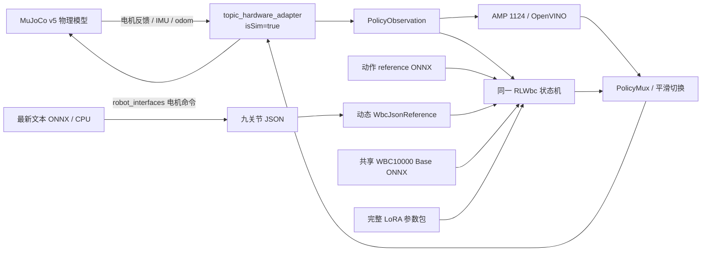

# sim2mujoco 操作手册

本手册适用于本机 x86_64 Linux、ROS 2 Humble 和分支 `experiment/stop-switch`。验证中途停止时，按下面的顺序执行到“退出与重试”即可。停止试验使用 AMP `l0_v5_amp_1124` 和交付包的 WBC Base `Sonic800 73983`。文末保留了模型和站姿采样说明。

## 构建

第一次使用、切换到试验分支、修改源码或清理过 `/tmp/l0-sim-install` 后，在一个新的 Bash 终端运行。已有本分支对应的仿真安装时，可直接从“加载终端环境”开始。下面的分支检查应输出 `experiment/stop-switch`。

```bash
cd /home/luvbotic/l0_deploy_v5_ws
git branch --show-current
source /opt/ros/humble/setup.bash
colcon --log-base /tmp/l0-sim-log build --base-paths src \
  --build-base /tmp/l0-sim-build --install-base /tmp/l0-sim-install \
  --packages-up-to legged_controllers legged_deploy legged_mujoco mujoco l0_v5_description legged_real \
  --packages-skip luvbot_cloud_bridge --executor sequential \
  --cmake-args -DLEGGED_DEPLOY_BACKEND=OPENVINO \
    -DLEGGED_DEPLOY_WBC_SIM=ON -DCMAKE_BUILD_TYPE=Release
```

构建使用系统 OpenVINO C++ Runtime 和 MuJoCo、GLFW、ROS 编译依赖。`legged_real` 提供本地仿真用的 `topic_hardware_adapter`。启动 MuJoCo 窗口的终端需要有效的 `DISPLAY`。下文统一使用上述独立安装目录。

## 加载终端环境

打开三个 Bash 终端，**A、B、C 各执行一次**。A 保留启动日志，B 播放动作，C 在动作执行期间发停止命令。

```bash
cd /home/luvbotic/l0_deploy_v5_ws
source /opt/ros/humble/setup.bash
source /tmp/l0-sim-install/setup.bash
export ROS_LOCALHOST_ONLY=1 ROS_DOMAIN_ID=77
ros2 pkg prefix legged_controllers
```

每个终端最后一行应输出 `/tmp/l0-sim-install/legged_controllers`。控制工具固定使用本机 ROS 域 77。普通动作和文本动作共用这个域，每次启动一个入口。

## 运行中途软停止

**1. 终端 A 启动仿真并启用软停止。** 专用入口自动加载交付 Base、15 条参考及 AMP 实测站姿。

```bash
ros2 launch legged_controllers sim2mujoco_stop.launch.py
```

等待 MuJoCo 窗口打开。终端 A 应显示加载 `l0_v5_amp_1124/policy.onnx`、`WBC fixed Base loaded once` 和 `WBC worker ready: 50 Hz, 15 motions preloaded`。

**2. 终端 B 进入零速 AMP 并启动 120 秒随机上肢动作。**

```bash
ros2 run legged_controllers mujoco_control walk
```

在 A 看到 `Standby -> Walking` 后等约 5 秒。确认站稳后在 B 播放，C 可提前准备好下一步的命令。

```bash
ros2 run legged_controllers mujoco_control action stand_random_upper_120s
```

B 输出 `started` 后会等待动作结束。起始保持 1 秒，随后以 50 Hz 播放 6000 帧随机上肢动作。双腿保持站姿参考，可从窗口观察手臂和头部变化。此动作的终端默认等待 150 秒。

**3. 动作进行中，在终端 C 发送软停止。** 可以先观察 20～30 秒，选手臂明显抬起的时候执行。观察手臂收回和随后站稳的过程。

```bash
ros2 run legged_controllers mujoco_control soft-stop
```

**4. 在终端 A 判断 AMP 是否接管。** C 显示 `Sent soft STOP` 表示命令已发送。按顺序查看 A 的日志，并在最后一条出现后继续观察约 3 秒。

| 终端 A 日志片段 | 表示什么 |
|---|---|
| `MuJoCo soft STOP requested` | 播放器收到当前动作的停止请求 |
| `soft STOP blend starts at reference frame` | 开始收回上身，腿部保持当前参考 |
| `soft STOP gate at frame`、`stopped: soft stop settled` | 连续五拍满足交接条件，动作结束 |
| `WBC -> AMP handoff blend 0.350s` | 开始向 AMP 交接，观察过渡后机器人是否保持双脚站稳 |

`stand_random_upper_120s` 实测在第 1343 帧（动作约 26.86 秒）开始收势，第 1377 帧满足交接条件。左肩侧抬角从按停时的 0.041 rad 回到 3 秒后的 −0.942 rad，收回约 56°。AMP 第一拍相对交接前电机目标的最大差为腿部 0.244 rad、上身 0.097 rad。0.35 秒过渡后的约 3 秒内，1500 个采样点均为双脚受力。手动操作时帧号随按停时机变化。[随机上肢实测记录](../../../experiments/stop_switch/l0_v5_amp_1124/stand_random_upper_120s_handoff.json) · [短动作 A-C04_mod 对照](../../../experiments/stop_switch/l0_v5_amp_1124/ros_handoff.json)

要对照自然播完的效果，待 AMP 接管并站稳，在 B 再执行一次同一条播放命令，让它跑满约 121 秒。实测自然播放 6050 拍（含起始保持），推理超时 0 次。B 应显示 `completed`，A 应显示 `stopped: completed` 和 `WBC -> AMP handoff blend 0.350s`。

### 用同一个 Base 测另外 14 个动作

终端 A 保持 `sim2mujoco_stop.launch.py` 运行。终端 B 把命令末尾替换为下表中的动作 ID。例如：

```bash
ros2 run legged_controllers mujoco_control action L0_direct_01
```

看到 `started` 后，在终端 C 执行 `ros2 run legged_controllers mujoco_control soft-stop`。有些动作只有 6～8 秒，C 可以提前准备好命令。WBC 在双脚稳定受力后开始收上身，腿部仍保持当时的参考。观察 A 的 `soft STOP gate` 和 `WBC -> AMP` 以确认交接。若保持 WBC，可按下节的急停与重启步骤切换到下一次试验。

| 动作 ID | 播放帧数 | 自然完成时间（秒，含起始保持） |
|---|---:|---:|
| `L0_angry_baoshouqiaojiao` | 446 | 9.92 |
| `L0_sad_8` | 359 | 8.18 |
| `L0_backseat_A` | 924 | 18.48 |
| `L0_box_1_A` | 649 | 12.98 |
| `L0_box_2_A` | 308 | 6.16 |
| `L0_box_3` | 466 | 9.32 |
| `L0_caipanwu_A` | 891 | 17.82 |
| `L0_direct_01` | 933 | 18.66 |
| `L0_sing_01` | 528 | 10.56 |
| `L0_taiji_01` | 519 | 10.38 |
| `L0_taiji_1_A` | 523 | 10.46 |
| `L0_yoga_X` | 541 | 10.82 |
| `L0_angry_8_E` | 336 | 7.72 |
| `L0_billiejean_D` | 901 | 18.02 |
| `stand_random_upper_120s` | 6000 | 121.00 |

15 个动作共用一个 CPU actor 实例。模型 SHA-256 为 `a7a3c02c03989afbae331e7dd723752e19b535ba4286b720ae5822dc978e795c`，与交付包的 `model/actor.rknn.json` 所记 ONNX 源哈希一致。14 个交付动作的 ONNX 参考与配置也逐一匹配交付清单哈希。随机上肢的参考来自已有动作的逐帧 RKNN 输出，跳过源配置的第 0 帧，保留其后 6000 帧；使用相同 Sonic800 Base。

独立 MuJoCo 对照从各动作首帧姿态开始，14 条均能自然播完。在动作中点请求停止，并从此后第一个满足条件的双支撑时刻开始收上身，`L0_direct_01`、`L0_sing_01`、`L0_angry_8_E` 在该次试验中交接后站稳，其余 11 条在收势后 3 秒内仍未满足条件。每条仅测一个请求相位。正式 ROS 另复测了 `L0_direct_01`：第 451 帧开始收势，第 485 帧交接，随后约 3 秒持续双脚受力。[逐动作停止记录](../../../experiments/stop_switch/l0_v5_amp_1124/sonic73983_motion_stops.json)

### 退出与重试

- **正常退出**时，在终端 A 按 Ctrl+C，等待启动脚本清理子进程后再启动下一场仿真。
- **需要立即急停**时，在终端 C 执行 `ros2 run legged_controllers mujoco_control stop`。控制器进入紧急阻尼。要从头重试，在 A 退出并重新启动，然后在 B 重新执行 `walk`。
- C 提示 `No soft-stop trial subscriber` 时，检查 A 是否使用 `sim2mujoco_stop.launch.py`，并核对三个终端的安装目录。提示 `No fresh active WBC command` 时，等下一次动作的 `started` 再发送。
- A 已收到请求但未出现 `soft STOP gate` 时，查看机器人是否双脚受力、身体是否稳定。腿姿与 AMP 相差过大时，WBC 会继续保持收势姿态。B 的 `action` 命令超时只结束终端等待，控制器仍按实际条件决定是否交接。

### 可选：记录自己的交接数据

需要保留本次按停的数据时，在准备按停的那次播放前另开一个终端，执行上文“加载终端环境”的命令，再开始录包。

```bash
stop_bag="/tmp/l0-soft-stop-$(date +%Y%m%d-%H%M%S)"
ros2 bag record -o "$stop_bag" \
  /experiment/stop_switch/request /experiment/stop_switch/support \
  /control/policy/observation /control/policy/command/wbc /control/policy/command/rl \
  /system/state_machine/wbc_action_fdb /odom
```

看到启动日志中的 `WBC -> AMP handoff blend 0.350s` 后再录至少 4 秒。在录包终端按 Ctrl+C，等写盘结束后执行 `ros2 bag info "$stop_bag"`。包中 `support` 记录双脚法向力和仿真电机使用的目标角，`command/rl` 记录 AMP 的目标角，两者可按消息时间戳对齐。

## 启动和操作

### 普通固定动作

如果只需要播放固定动作，终端 A 可用下面的普通启动命令。这个入口加载原 14 个 LoRA 动作。先退出上面的 Sonic800 停止试验，再启动普通仿真。

```bash
export ROS_LOG_DIR=/tmp/l0-sim-roslog
ros2 launch legged_controllers sim2mujoco.launch.py
```

终端 B 在新启动的仿真中先进入 Walking，然后任选一个动作执行。

```bash
ros2 run legged_controllers mujoco_control walk
sleep 5

ros2 run legged_controllers mujoco_control action L0_strange_new_1_A
ros2 run legged_controllers mujoco_control action L0_strange_1
ros2 run legged_controllers mujoco_control action L0_excited_8
ros2 run legged_controllers mujoco_control action L0_angry_new_2
ros2 run legged_controllers mujoco_control action A-C04_mod
```

`walk` 等价于手柄 B+Y，进入零速度 AMP；首次进入后等待约 3–5 秒，确认姿态稳定再请求动作。动作必须在控制器允许、姿态正常、观测新鲜且没有其他动作运行时执行。`action` 等待 `completed`，拒绝、失败或超时返回错误，不跳过状态机。

### 指定终端动作完成后进入 Emergency（仅 MuJoCo）

2026-11-09 新增：普通仿真入口默认
`wbc_emergency_after_actions:='[L0_crouch_off]'`。终端执行：

```bash
ros2 run legged_controllers mujoco_control action L0_crouch_off
```

动作正常播放完成后，控制循环直接进入 `EmergencyStop`，不等待 AMP 新指令、
不执行 WBC→AMP 过渡。终端仍收到一次 `completed`，因为动作本身成功完成；
launch 日志同时显示 `on_finish=emergency_stop (no AMP handoff)`。
其余 13 个动作正常完成后仍返回 AMP。推理失败、中途急停等原有路径仍报告 `failed`。
没有新增手柄动作绑定，也没有修改真机启动参数或模型；该功能只在 `isSim=true` 时读取配置并生效。

名单可在启动时指定多个完整动作 ID，空列表可恢复全部动作返回 AMP：

```bash
ros2 launch legged_controllers sim2mujoco.launch.py \
  wbc_emergency_after_actions:='[]'
```

名单中的动作还必须存在于所选仿真包且被 `wbc_policies` 预加载；此名单不会自动加载模型。
完成时间包含 `start_hold_sec` 和全部 reference 帧，不会提前跳过尾部静止帧。
Emergency 使用原有阻尼输出（Kp=0、目标速度和前馈力矩为0、Kd默认5），不会主动保持最后姿势。
进入 Emergency 后不能直接再发动作；无需手柄的重复测试可退出并重新启动仿真，再执行 `mujoco_control walk`。

### 文本生成与执行

文本生成使用与 ROS Humble ABI 一致的 Python 3.10，并安装 NumPy、PyYAML、ONNX Runtime。不要把 Python 3.12 的 conda 环境直接用于 rclpy。可为本机单独准备依赖：

```bash
/usr/bin/python3 -m pip install --target /tmp/l0-sim-python 'numpy<2' 'onnxruntime==1.23.2'
export PYTHONPATH=/tmp/l0-sim-python:${PYTHONPATH:-}
```

终端 A 先用 Ctrl+C 退出普通仿真，等它退出后启动文本入口。

```bash
ros2 launch legged_controllers sim2mujoco_text.launch.py wbc_emergency_after_actions:='[]'
```

终端 B 进入 Walking 并等待约 5 秒，再生成并执行动作。

```bash
ros2 run legged_controllers mujoco_control walk
sleep 5
export PYTHONPATH=/tmp/l0-sim-python:${PYTHONPATH:-}
sim_policy_share=$(ros2 pkg prefix --share legged_deploy)
sim_control_share=$(ros2 pkg prefix --share legged_controllers)
sim_mapping_share=$(ros2 pkg prefix --share system_command_arbiter)
ros2 run legged_controllers text_mujoco_generate \
  --model "$sim_control_share/texttomotion/baseline/onnx/manifest.json" \
  --bundle "$sim_policy_share/policy/l0_v5/text_wbc_sim/base_manifest.json" \
  --mapping "$sim_mapping_share/config/l0_v5.yaml" \
  --text '点头' --output "/tmp/mujoco_text_action_$(date +%s%N).json" --execute
```

输出文件禁止覆盖，每次使用新文件名。`text_mujoco_generate` 选用 `onnx-reference` CPU 后端，`--execute` 必须使用实时观测；离线 snapshot 不可执行。仅生成 JSON 时去掉 `--execute`。

## 停止切换试验的 AMP 站姿参考（2026-11-24）

`sim2mujoco.launch.py` 默认选择 `l0_v5_amp_1124`，文本仿真入口继承该默认值。模型取自下载目录的 `policy.onnx`。新旧 ONNX 的关节顺序、观测缩放、动作缩放和历史长度一致，新策略沿用 AMP10281 的部署站姿、PD 和手柄配置。复测旧模型可传 `subpolicy:=l0_v5_amp_10281`。真机启动入口默认使用 AMP10281。

本轮通过上述仿真入口加载新 AMP，进入 Walking 并保持零速度命令。站稳后取连续 150 个 50 Hz 策略周期，首末时间戳相隔 2.980 s。参考帧选取实测关节角最接近窗口逐关节中位数的一拍（从 0 开始的第 74 帧）。骨盆高度为 0.454837 m，两脚相对窗口首帧的最大位移均小于 0.063 mm。

- [站姿参考 JSON](../../../experiments/stop_switch/l0_v5_amp_1124/stand_reference.json) 包含 21 个关节的名称、实测角 `q_stand_rad`、同拍 AMP 目标角 `q_target_amp_rad` 和实际下发目标 `q_target_sent_rad`。补间终点取实测角。本窗口内实测与 AMP 目标的最大差为 0.13293 rad，出现在左髋 roll。
- [完整窗口 NPZ](../../../experiments/stop_switch/l0_v5_amp_1124/stand_window.npz) 每行对应一拍 AMP 输出。使用策略消息的时间戳和序号，将本周期电机命令按方向、减速比和零偏还原至关节坐标，与 AMP 输出逐关节匹配，最大差为 1.19×10⁻⁷ rad 以内。关节反馈和里程计取同一 MuJoCo 发布时刻，与对应下发命令的时间差最大为 1.63 ms。
- 骨盆取 `base_link`，双脚取左右 `ankle_roll_link`。位姿在 `odom` 系下，以米及 `xyzw` 四元数存储。足端位姿按实测状态和启动场景做 MuJoCo 正运动学重建，150 拍均检测到双脚碰撞几何与地面接触。

仿真退出时桥接器报告电机禁能确认超时，发生在录包结束之后。后续动态试验已覆盖正式 ROS 交接和 PartyMimic 左右脚支撑对照。[动态停止试验记录与复现](../../../experiments/stop_switch/README.md)

### 软停止的交接条件

软停止请求绑定正在播放动作的交接编号。零速度命令下，播放器继续读取原动作，直到双脚各受力超过 2 N、基座水平速度小于 0.12 m/s、角速度小于 0.6 rad/s，且机身倾斜小于 15°。此时锁定当前根位姿和腿部参考，用当前上身速度做 30 个间隔的 Hermite 补间。末端保持后，按实际交接的历史初始化方式预计算零速 AMP 第一拍，将其与仿真 PD 实际使用的关节目标逐关节比较。连续五拍满足支撑与运动条件，且腿部、上身最大目标差分别小于 0.45、1.5 rad 时，走现有 0.35 s WBC→AMP 交接。条件未满足时继续 WBC 跟踪。这些阈值仅用于本轮仿真。

`mujoco_control stop` 仍触发原有急停。配置为完成后急停的动作会拒绝软停止请求。正式 ROS 入口本轮验证的是保留下身、收回上身的路径；全身补间与指定落脚帧的对照只在独立仿真中运行。

## 当前仿真物理模型

两个仿真入口默认通过 `scene_file` 加载 `l0_v5_description/mjcf/l0_base_hip_collision_split_experimental.xml`，来源为用户指定的 `/home/luvbotic/.local/share/Trash/files/l0_mimic_lite_2/l0_mimic-lite/l0_v5_description/mjcf/`。XML 与其 49 个分块碰撞网格已复制到源码并随 description 包安装，运行不依赖回收站路径。其余 22 个引用网格与部署包现有文件逐字节一致。

XML SHA256：`b1a54eac002742e718781a77ab3056a9e9528108e2c9fdd057ad6de881d5d254`。源文件保留了 experimental 标注；这是本次用户指定的仿真模型，未用作真机配置。

原 `mjcf/l0_v5.xml` 也属于 v5，但不是此碰撞拆分版本：新文件增加/调整碰撞几何，双膝 XML 范围从 0～1.97222205 rad 改为 0～2.35619449 rad；惯性与 actuator 配置一致。原文件和控制器保护阈值未修改。需要显式选择旧模型时可传 `scene_file:=/绝对路径/l0_v5.xml`。

此前测试记录中的五动作和文本闭环结果使用旧 XML，不能直接视为当前碰撞模型的动作质量验收。

## 组成与数据流



WBC 是一个共享 Base 实例，输入仍为 `policy[399]`、`command_short[240]` 和 31 个 adapter 参数张量，输出为 21 关节 action。LoRA 包包含 A/B、bias 与 LayerNorm 完整参数；在两个参数槽间 prepare/commit/rollback 切换。没有为每个动作复制一份合并策略。

OpenVINO 使用 FP32 输入和计算、FP16 存储的 Base 常量，加载同一二进制格式的 FP16 LoRA。`LEGGED_DEPLOY_WBC_SIM=ON` 才编译此后端，默认 OFF；RKNN 构建继续使用原 `RknnModel`。

MuJoCo 桥接层适配当前真机使用的 `robot_interfaces` 电机协议，按映射中的关节名称解析 actuator、qpos、qvel 地址，不能假设 MJCF 中 actuator 排序等于控制顺序。保留命令时效、非有限值检查、禁能与反馈检查；模拟器不执行电机校准。模型载入并发布 IMU 后才启动控制器；首次使能之前支撑初始姿态，首次使能后正常运行物理，故障后不会冻结物理掩盖跌倒。

仿真入口默认 `joint_limit_time_constant:=0.004`（物理步长 0.002 s 的两倍），仅调整 MuJoCo 的软关节限位约束时间常数；关节角度范围、控制器保护阈值、反馈值和策略参数均不改变。原 XML 的 0.02 s 约束在 angry 动作中允许较大穿透并触发保护，最终配置的测试结果见测试记录。参数为 0 时保留 XML 设置。测试使用启动时载入的模型，不覆盖 GUI 中手动重载模型的场景。

## 两部分功能和资产

### 普通 WBC 动作

`sim2mujoco.launch.py` 默认开启 WBC + LoRA，使用 `policy/l0_v5/wbc_lora_sim`，现交付 14 个动作，原有六个如下：

| 动作 | reference | LoRA 来源 |
|---|---|---|
| `L0_strange_new_1_A` | wholebody1102 新 reference，378 帧 | 同动作 `lorackpt_2000.pt` |
| `L0_strange_1` | wholebody1102 新 reference，402 帧 | 同动作 `lorackpt_2000.pt` |
| `L0_excited_8` | wholebody1102 新 reference，402 帧 | 同动作 `lorackpt_2000.pt` |
| `L0_angry_new_2` | wholebody1102 新 reference，384 帧 | 同动作 `lorackpt_2000.pt` |
| `A-C04_mod` | 指定原始 JSON 的 360 帧，加既有 100 帧起止过渡 | “稳定下半身，强化上半身/lorackpt_2000.pt” |
| `L0_crouch_off` | 与真机包来源 SHA256 一致的 reference ONNX，126 帧 | 复制匹配共享 Base 的真机 `wbc_lora_fp16` 参数包，仅新增仿真副本 |

另有 8 个手柄绑定动作：`L0_fear_7_A`、`L0_excited_1`、`L0_excited_new_1`、`L0_excited_new_5`、`L0_satisfied_10`、`L0_SayNo_17`、`L0_angry_9`、`L0_angry_new_1`。它们使用与当前真机包对应的 LoRA/config 和 reference ONNX；新增副本仅放在仿真包。组合键、终端并用和禁用参数见 [WBC 手柄控制说明](joystick-wbc-control.md)。

四个新动作源目录为 `/home/luvbotic/checkpoints/wholebody1102/bushu_4motion_1102`。其 reference 前处理后的 ONNX 哈希与当前真机包转换记录中的源哈希一致。

`A-C04_mod` 原 JSON 为 `/home/luvbotic/json1009/新json/A-C04_mod.json`。本次复用了此前由该 JSON 导出的 reference ONNX，并检查来源 JSON 字节相同、全部 360 帧在左右臂镜像转换后与 reference 对应帧完全一致。原文件和该 reference 使用的 AMP 站姿采样记录归档在仿真包 `sources/`。此静态 reference 的下半身是采样站姿；文本动态 reference 的下半身来自生成时的实时快照，两者不应混淆。

### 文本生成动作

`sim2mujoco_text.launch.py` 复用同一仿真入口，选择 `text_wbc_sim`，只预载 `UpperBody_Enhanced` 参数包：

1. 使用 20261102 最新文本交付包中的 `qwen_tokenizer.onnx` 和 `inbetweener.onnx`，在 CPU 生成九关节 JSON。
2. 采集新鲜、已启用的 `PolicyObservation`；使用 MuJoCo 实测基座位姿作为 JSON root reference。
3. WBC 完整校验 JSON、登记动态 `T_*` reference。
4. 通过正式动作命令进入同一 WBC prepare/start/complete 流程，加载 `UpperBody_Enhanced` LoRA。
5. 完成后平滑切回 AMP。

仿真文本包显式标记 `simulation_json_only`，无需静态启动 reference；直接请求静态 `UpperBody_Enhanced` 动作会被拒绝。JSON 仍需满足来源、Base 身份、关节顺序、时效、限位与实时快照检查，生成期间观测失效或姿态变化过大时拒绝执行。真机仍保留原静态 reference 初始化方式。

### Base 和 LoRA 身份

共享 Base 对应 `/home/luvbotic/l0_mimic-lite/checkpoints/base_wbc10000_20261024/checkpoint_10000.pt`：

- checkpoint SHA256：`f02d4845019346b577fb0babceb8c288e1b5e1694f7888907ae8cfd63d7e4142`
- 共享动态 Base ONNX SHA256：`ecbfe4b4dabe6ee284fd756aabed60288bd52d216e4c3c0e7ac18a48c51da418`
- 本次指定上半身 PT 导出的 weights SHA256：`d089b409ffa3ee93b6d006c41c3c2acc4d1c447ed72f04504b8f4bd2e371f4c4`

仿真 `A-C04_mod` 和仿真文本 `UpperBody_Enhanced` 的 `weights.bin` 逐字节相同，A/B 非全零。注意：此指定 PT 与原真机 `text_wbc_bundle` 中 SHA 为 `a3e77f…` 的 weights 不同。本次按用户指定 PT 配置仿真，**没有更新真机包**。详细来源见两个仿真包的 `SIMULATION.json`。

## 真机链路的边界

`sim2real.launch.py`、`sequential_launch_real.sh`、`text_wbc.launch.py`、真机硬件驱动源码、`wbc_lora_fp16`、`text_wbc_bundle` 以及 AMP10281 资产保持原字节。共享入口新增的 `wbc_inference` 默认仍是 `rknn`；共享 C++ 中仿真分支受 `USE_WBC_OPENVINO` 编译条件控制；真机文本生成入口仍默认 Lite2，执行仍要求板端后端和实时观测。

本次不连接真机，也不修改任何远端工作区。

测试范围、实测结果和限制见 [sim2mujoco 测试记录](sim2mujoco-testing.md)。
