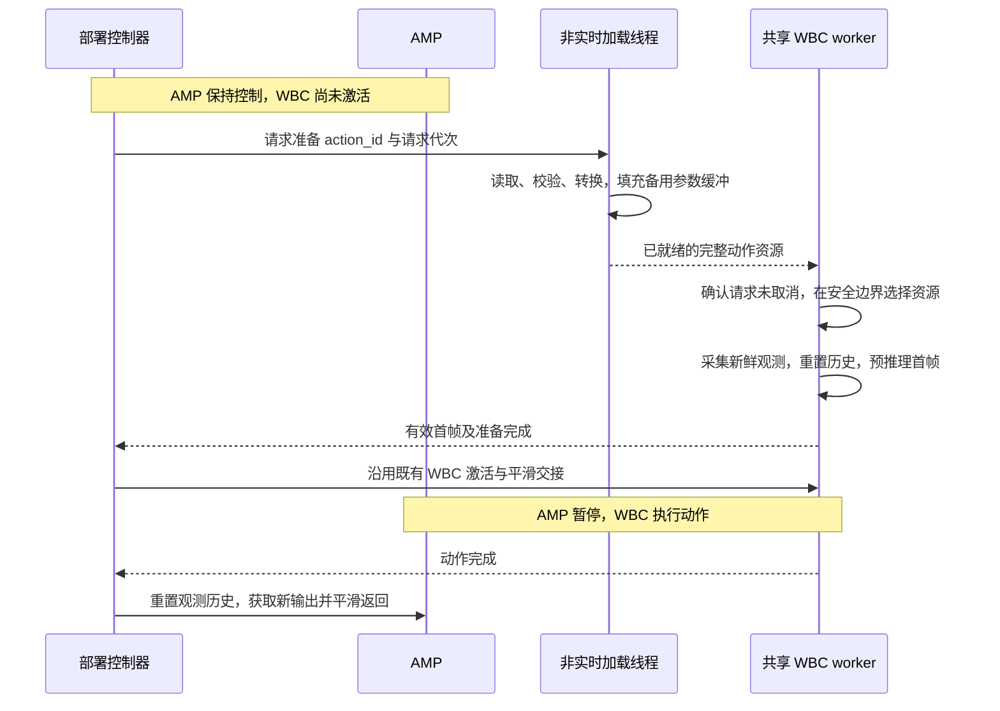

# RK3588 WBC-LoRA 动态加载部署方案

整理日期：2026-10-26。状态：**初步可行，可进入验证开发；目标 RK3588 的动态图执行及实时性能尚未验收。**

本方案结合当前部署代码和本地轻量训练结果修订。AMP 保留，emotion 动作共用一份 WBC 基础策略，在动作激活前动态加载完整适配参数。原有部署步骤及底层启动约定继续保留，本文明确模型资产及部署代码需要增加的能力。

相关文档：[现有部署流程与 ROS 2 工作机制](deploy-workflow.md)、[可行性审阅及代码依据](wbc-lora-feasibility-review.md)、[原始总体方案归档](wbc-lora-proposal-original.md)。原始方案用于追溯，实施参数范围和验证边界以本文及审阅结论为准。

验证路线已明确：[本地 ROS 2 与板端无 HPM smoke 工作流](wbc-lora-validation-workflow.md)。本地 sim2mujoco 使用 OpenVINO 执行同源 ONNX，并复用实际加载/切换流程；主要数值 smoke 在机器人 RK3588 上独立运行，不启动 HPM 或硬件适配器。最终 policy 与 reference_motion 均为 FP16 RKNN。

开发落点见[文件级开发规划](wbc-lora-development-plan.md)：明确现有/新增代码、参数及线程调整，按 P0–P4 实施；首个板端 smoke 先于完整本地仿真接入。

## 1. 初步可行性的认定范围

可以初步认定两点：模型可保持一张完整计算图，将共享基础矩阵与动作相关参数分开表达；现有 AMP/WBC 准备、激活及返回流程可以承接按需加载，不需要因共享模型而重设底层启动方案。

尚未确认两点：实际 RKNN 编译结果是否将全部动态参数计算交由目标 NPU 执行；完整 WBC 周期是否满足现有 20 ms 预算。功能、精度及性能证据齐全后，才能认定板端部署验证通过。

本轮使用轻量包中实际存在的 10 个 affectionate 动作即可开展验证。至少选两套真实适配器测试切换，随后覆盖该子集全部动作；不要求先补齐原索引中的 80 个动作。

## 2. 已核对的模型与训练资产

训练结果目录：`/home/luvbot/SC/L0_V5_WBC10000_LoRA80_20261026训练结果/`。

| 内容 | 已确认事实 |
| --- | --- |
| 共享 Base | `base/base_ckpt.pt`、`base/policy.onnx`、`base/policy.yaml` |
| Adapter | `lora/<emotion>/<motion>/lorackpt_2000.pt`，格式为 `mimic_lite_lora_adapter_v2` |
| 参考动作 | 同动作目录的 `motion/reference_motion.onnx` 和 NPZ |
| LoRA 结构 | 7 个 Linear，rank=16，alpha=16，scale=1 |
| 策略输入/输出 | `policy[399]`、`command_short[240]` → `action[21]`，均为 float32 原生接口 |
| 真实 Linear 尺寸 | 按 `[out,in]`：`[1024,639]`、`[1024,1024]`、`[1024,1024]`、`[1024,1423]`、`[1024,1024]`、`[1024,1024]`、`[21,1024]` |
| 非线性及拼接 | 保留 5 处 LayerNorm/Mish、encoder 输入拼接和 decoder 前的 1423 维拼接 |
| 归一化 | 已在 Base ONNX 图内；本地 10 套 adapter 的 vecnorms 与 Base 完全一致 |
| 构建基线 | 当前转换器使用 `do_quantization=False`；最终 policy/reference 明确采用非 INT8 的 FP16 RKNN |

Base checkpoint SHA256：

```text
f02d4845019346b577fb0babceb8c288e1b5e1694f7888907ae8cfd63d7e4142
```

使用交付包相对路径重定位资产，不沿用 checkpoint 中训练服务器的绝对路径。索引仅用于发现和核对，只有实际存在且校验通过的动作才注册进本轮运行集合。

## 3. 共享与动态参数的边界

共享基础 Linear 矩阵 `W_base`。每个动作动态加载：

- 7 层的 A/B，共 14 个张量。
- 7 个 Linear bias，采用动作训练后的替换值。
- 5 层 LayerNorm 的 gamma/beta，共 10 个张量，采用动作训练后的替换值。

真实计算保持：

```text
linear_k(x) = x @ W_base.T + b_k
              + (alpha / rank) * ((x @ A_k.T) @ B_k.T)

在原网络规定的位置执行 LayerNorm 和 Mish，保持原拼接、轴和 epsilon。
```

原方案“基础 bias 固定，只动态输入 A/B”的表达必须修正，否则遗漏已训练参数。LayerNorm 可以在同一图内表达为无仿射归一化再乘 `gamma_k`、加 `beta_k`；数学语义保持一致，编译和数值误差仍需验证。

当前确定性 `action` 图不使用 `actor_std`，因此该字段无需进入板端均值前向；导出规范需记录这一处理。输入归一化暂保留共享常量，并在 adapter manifest 中绑定归一化哈希。未来若统计不同，必须明确参数化或拒绝不兼容 adapter，不能重复归一化或静默套用旧值。

动态参数是固定形状、运行时改变数值，不要求动态 shape。可先以逐张量输入证明功能，再评估打包输入；逐张量方案含 31 个动作参数输入和 2 个观测输入。采用打包时，拆包算子也属于 NPU 验证范围。

按实际形状，A/B 的 FP16 原始数据约 417.09 KiB；加上 bias 和 LayerNorm 后约 449.13 KiB，不含对齐、manifest 和可选归一化数据。最终 policy 和 reference RKNN 使用 FP16；参数包及外部 I/O 的 dtype 单独声明、转换和校验，不能把 FP16 文件直接作为现有 FP32 指针传入。CPU 对照保留 FP32，接受合理的 FP16 舍入差异。

## 4. 拟实施的部署资产布局

以下为待实现的目录规范，当前 launch 尚未支持；它说明新的模型资产组织方式，不替换现有部署流程中的启动顺序。

```text
legged_deploy/policy/<robot_type>/wbc_lora/
├── base_lora.onnx
├── base_lora.rknn
├── base_manifest.json
├── adapters/
│   └── <action_id>/
│       ├── manifest.json
│       └── weights.bin
└── actions/
    └── <action_id>/
        ├── rl_config.yaml
        ├── reference_motion.onnx
        └── reference_motion.rknn
```

离线导出时，读取 Base 和原始 adapter，将完整适配参数写成有固定格式的部署包。板端不直接解释 `.pt`，也不存储每个动作各一份完整 policy RKNN。

manifest 至少记录：格式版本、adapter/action ID、Base checkpoint 哈希、共享 RKNN 哈希或 ABI 版本、层名、形状、rank、alpha、dtype、端序、字节偏移、大小、文件校验值及归一化标识。

同批导出的 ONNX 和 RKNN 均记录版本/哈希。本地与板端读取同一 adapter/config/reference 绑定关系，仅由明确选择的模型执行器加载各自格式；不能在本地重新从 `.pt` 实现另一套动作加载流程。

每个动作必须成套绑定 adapter、reference、关节顺序、默认位置、动作缩放/裁剪、增益及帧数/时序。不能仅按同名动作复用旧参考资产。reference 继续使用当前接口；首阶段可保留选定子集 reference 的预加载方式。

“一份常驻模型”指共享 policy 图及其一个 Context；reference RKNN 有独立 Context，其内存和耗时分别统计，不计作重复的基础 policy。

## 5. 加载、准备及生效策略



加载职责与推理职责分开：加载线程处理磁盘、manifest、哈希、布局和 dtype 转换；推理所有者负责 RKNN 调用、输入绑定及安全边界提交。后台线程不得并发修改当前推理读取的参数。

适配参数采用预分配活动/备用缓冲。旧缓冲在没有在途读取后才可复用；必要的设备内存同步按实际 SDK 调用模式实现。共享 policy Context 不随动作重建，参数缓存采用有界策略，不能因动作数增加而无界驻留。

动态加载发生在动作激活前，保持现有“执行中不接受另一动作”的规则。准备失败时 AMP 继续控制；超时、取消、急停后，迟到的加载结果不能激活旧请求。动作运行期间的过期输出或传感器/推理错误仍使用现有故障路径。

现有命令默认有效期为 100 ms，准备服务及新输出等待默认超时为 0.5 s。因此必须在加载完成后再采样和生成首帧；若冷加载超过准备预算，应采用预准备/缓存或明确加载等待协议，不能把磁盘等待塞进推理周期。

现有 `wbc_action_cmd`、`action_id`、反馈话题及下游控制接口可以保留。是否增加独立加载接口取决于准备时延的实测结果，不把新增 ROS 服务作为初步方案成立的前提。

## 6. 部署代码的具体修改落点

| 文件或模块 | 拟修改内容 |
| --- | --- |
| 离线导出包装与参数导出工具 | 按真实前向图导出动态 A/B/bias/LayerNorm 输入；生成部署参数包及 manifest；核对确定性输出和归一化 |
| `prepare_wbc_deploy.py`、`convert_onnx_to_rknn_rk3588_wbc_policy.py`、批量转换编排 | 增加动态参数 ABI 检查，转换一次共享 policy；逐动作准备 adapter、reference 和配置。复用现有非量化及兼容改写路径 |
| `legged_deploy/include/rl_controller_wbc.h`、`src/rl_controller_wbc.cpp` | 将 policy 从 `Motion` 移到 worker 级持有；Motion 绑定 reference、adapter 及配置；实现加载代次、取消及安全提交 |
| `legged_deploy/include/rknn_model.h`、`src/rknn_model.cpp` | 增加所需 shape/dtype/布局检查，支持固定参数输入及缓冲复用；保持现有调用兼容性、有限数值及错误检查 |
| WBC 公共执行逻辑、OpenVINO 适配及 `legged_deploy/CMakeLists.txt` | 共用加载、reference 查询及输入组装，解除公共逻辑的 RKNN-only 限制；本地使用已有 OpenVINO CPU 依赖，板端保持 RKNN |
| `legged_controllers/launch/one_start.launch.py`、sim2mujoco 与实机参数链 | 按明确后端及共享模型/动作条目检查资产，不再要求每个动作各有完整 policy RKNN；统一传递配置，维持启动编排顺序 |
| `LeggedControllerWbc.cpp`、`PolicyMux.cpp` | 复用 AMP 前置条件、动作校验及平滑交接，适配准备等待与取消协议，确保动作配置和增益成套生效 |
| 独立板端模型 smoke 入口 | 复用正式模型及 adapter 加载路径，固定状态对照 reference/policy；不启动 HPM、硬件适配器或电机通信 |

若要求实时路径无内存分配，还必须处理现有输入描述数组及观测/参考向量的分配；仅对 adapter 使用双缓冲不能自动满足整条路径要求。

## 7. 验证阶段与通过条件

| 阶段 | 工作与通过条件 |
| --- | --- |
| A：完整参数的离线等价性 | 至少两个真实 adapter，动态图输出分别对齐各自最终 checkpoint；A/B、bias、LayerNorm、归一化全部纳入；Base 参数可恢复 Base 输出 |
| B：真实参数化 block | 使用实际 639/1423/21 等形状、rank=16，在同 Context 上切换参数；确认数值、算子后端和输入绑定行为 |
| C：板端完整 FP16 模型 smoke（主要 smoke） | 不启动 HPM 或硬件适配器；固定状态分别验证 reference、policy 及组合链，执行 `A → B → A`；核对完整动态图 NPU 执行、精度、内存及输入开销 |
| D：本地 ROS 2 / sim2mujoco 集成 | OpenVINO 执行同源 ONNX，复用加载/切换逻辑；验证 `AMP → A → AMP → B → AMP → A`、坏包、取消、迟到结果、超时及返回，不以此代替 RKNN 精度/性能结论 |
| E：周期与资源 | 完整采样、reference 查询、参数输入/同步、policy 推理及输出处理满足现有 20 ms 判定；分别记录准备/切换耗时、P95/P99/max、超时、RSS 和设备内存 |

policy 和 reference 均按 FP16 非量化浮点路径构建，保留 FP32 ONNX 作为对照；不要求逐位一致，也不因末位误差反复调精度。转换参数、实际 I/O dtype 及容差需明确记录。不能以单层通过代替完整图通过，也不能以本地 CPU/Toolkit 模拟结果代替目标设备执行及实时测量。具体精度、状态数据和 smoke 分层见[验证工作流](wbc-lora-validation-workflow.md)。

优先完成板端参数化 block 和无 HPM 模型 smoke，再完善完整 sim2mujoco 测试。原有实机启动流程保留用于后续正式部署，本次 smoke 使用独立模型入口，不绕过或削弱正式硬件就绪检查。

若 RKNN 阶段受阻，记录精确算子、形状、Toolkit/Runtime/driver 版本和日志，再评估替代方案。不得静默删除已训练参数、改由 CPU 执行 LoRA 或为每个动作生成完整 RKNN 后宣布原路线已通过。

## 8. 当前实施状态

P0 离线代码、动态图、FP16 参数包及两动作 CPU 验证已交付，见 [P0 交付与手动真板验证](wbc-lora-p0-handoff.md)。当前没有生成或执行 RKNN，真板验收由用户手动控制。

已完成：方案与代码静态审阅、本地 10 套权重/归一化核对、真实图拓扑核对，以及本文和相关文档归档。

已确定后续验证分工：本地 OpenVINO/ROS 2 同源加载与 sim2mujoco 集成、板端不启动 HPM 的 FP16 模型对照为主要 smoke。

待完成：用户手动完成目标 SDK 转换/真板门槛、两个执行后端的正式公共 WBC 接入、C++ 组合 smoke、ROS 集成及完整周期验收。本状态下可进入验证开发，尚不代表已有可直接启动的 LoRA 部署程序。
