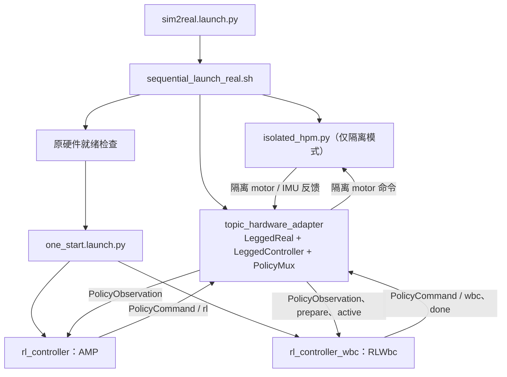

# WBC-LoRA 策略推理性能优化交接

更新：2026-10-27（开发始于 10-26，资产目录保留该日期）。**用户已提供常驻版本板端启动日志；FP16/AFFINE 初始化误拒绝已修复，修复版重建、数值和时序验收待执行。** 目标仍为 RK3588 / aarch64 / RKNN Runtime 2.3.2；本机检查不能作为板端通过依据。

### 2026-10-27 板端 FP16/AFFINE 兼容性修复

用户运行 `20261027_101415_NX6V6G` 中，WBC 在初始化 `command_short[240]` 时读到逻辑/native 均为 UNDEFINED、FP16、AFFINE、480 字节，因旧代码要求 `qnt_type==NONE` 而退出（255）。随后控制器明确进入 Walking；动作请求通过新鲜 AMP 检查后，因 prepare 服务不存在而被拒绝。单次 Walking 入口的命令过期记录不等于持续无法进入 Walking。

Rockchip 官方 RKNPU2 示例在 AFFINE 量化判断中明确排除 FP16。修复仅让逻辑和 native 属性接受 FP16/NONE、FP16/AFFINE、FP32/NONE；保留原 qnt/scale/zp，不对原生浮点字节执行整数反量化。整数、DFP、未知编码及不支持的布局仍被拒绝；诊断新增 zp/scale。依据：[Rockchip RKNPU2 YOLOv5 类型判断](https://github.com/airockchip/rknn_model_zoo/blob/main/examples/yolov5/cpp/rknpu2/yolov5.cc#L94)。

无需重新转换或安装模型，仅同步源码与校验清单、在板端重建 C++ 并重启整套链路。此修复未在板端运行，不能声称后续所有 native 属性、内存绑定、推理和 20 ms 时序已经通过。

## 本轮实现及验收结论

本轮依据 [常驻参数开发交接](../../../deliveries/wbc_lora_p0_20261026/WBC_LORA_RESIDENT_TENSOR_DEVELOPMENT_HANDOFF.md) 实施，覆盖已有六个运行时文件及两个导出/准备入口。原工作区已有修改保留，未改 SDK、CMake、launch、共享控制器、硬件桥或安全阈值。下文原有板端测量作为旧输入提交路径的历史基线保留。

- `RknnModel::InputMode::ResidentWbc` 只由共享 WBC policy 显式启用。原 `Copy` 默认、AMP/static/reference 的 `inputs_set → run → outputs_get/release` 保留；持久 Context 拒绝调用旧 `run(inputs, sizes)`。
- 启动时查询逻辑/native 属性，分配 31×2 参数内存、2 路观测和 1 路输出，共 65 个句柄；绑定观测/输出一次。按 `size_with_stride` 分配 cacheable 内存，确定性初始化 padding，真实 FP16/FP32 排布后才设置 pass-through。仅此 Context 使用输入/输出显式同步 flags。
- 当前映射支持本模型的 **UNDEFINED、1D/2D、FP16（NONE/AFFINE 标记）或 FP32/NONE**，允许最后一维 padding 和显式 width stride。所有逻辑形状继续匹配 manifest；native 外部布局若为 NC1HWC2/NHWC/NCHW、额外 rank 或无法解释的 stride，启动时报出该张量逻辑/native 属性并拒绝运行，不能手改 fmt 或忽略容量错误强行继续。转换日志的内部算子布局不能代替实际 native 属性验收。
- loader 保留 Base/schema/归一化/action/hash/range/finite 检查，prepare 内将完整参数集合写入备用设备内存。文件校验及排布在控制器推理锁外，排布不调用 SDK；所有 SDK 操作另受模型互斥锁保护。`loading_mutex_` 继续防止已取消的旧加载与新加载复用备用槽。
- 持控制器推理锁重新核对 generation/超时后，先同步完整备用参数，再绑定全部 31 张量。部分绑定失败重绑完整旧 slot；首帧/准备超时失败也恢复旧绑定及动作、历史、anchor、命令缓存。回退失败或 SDK 执行失败使该 Context 禁止继续推理，需重启；没有隐式 Base 回退。
- 初始 slot 0 仅提供完整的回退绑定，逻辑 active slot 为 -1，首个完整包成功提交前禁止推理。它不是有效的全零 Base 参数包。首次 Base 仍经过相同 prepare 和首帧验证。
- 稳态 `runResident()` 仅写/同步 policy[399]、command_short[240]，同步调用 `rknn_run()` 完成本帧后同步/解析 action[21]。不重新提交、排布或绑定参数，不混用 outputs_get/release。同步调用不启用 ASYNC_MASK/non-block/fence，不读取上一帧。关闭默认 cache flush 并不证明 SDK 内部完全没有搬运。
- 退出时 join 推理线程并退休 loader，随后释放句柄和 Context；主程序原有 executor cancel/join 先于 controller 析构。构造中途失败清理已分配句柄。驱动报错时的资源/恢复行为仍须板端故障覆盖。
- reference 保持原查询语义；原 20 ms、0.5 s prepare、输入时效、裁剪及输出交接规则保留。

### 无 LoRA 资产

`export_wbc_lora.py` 和 `prepare_wbc_deploy.py --mode lora` 新增 `--base-actions`，必须是 `--actions` 的无重复子集。static/install-lora 拒绝该选择参数。显式 Base 分支免读微调 adapter/final checkpoint；仍必须有有效来源 action、reference 和配置。每个动作独立保存完整同 schema 参数包和身份，不从资产损坏推断 Base 模式。

新包位于 `deliveries/wbc_lora_resident_20261026`：

| 动作 | 参数来源 | 33 个离线样本 FP32 最大误差 | 实际 FP16 payload 最大误差 |
| --- | --- | ---: | ---: |
| L0_Hugme | 原 LoRA | 8.6427e-7 | 0.00066835 |
| L0_act_cute_1 | 原 LoRA | 1.1623e-6 | 0.00042560 |
| L0_act_cute_2 | 显式 Base，14 个零 A/B + 17 个 Base bias/gamma/beta | 8.3447e-7 | 0.00043207 |

Base 的期望数组来自原 `base/policy.onnx`，同时核对 Base actor 和逐张量 FP16 打包值；三个 probe 覆盖三动作。最大 probe payload 误差 0.00383473，未放宽原 0.05 门限。相同合成输入的 CPU A→B→A、A→Base→A、Base→A→Base 检查通过，**不是板端常驻切换结果，也不是机器人 rollout**。见新包 `validation_report.json`。

新包与旧包共享图 ONNX 的 SHA256 均为 `ba408741f38513500f3f68a8d03b07e20580e265519a378995d6f08db50ea514`；Base/schema 指纹保持不变。动作目录、参数来源标注和期望数据改变 graph manifest，必须重新生成匹配转换记录并以新 bundle 名安装；不能复用旧 `.rknn.json` 或手改 hash。

### 诊断口径

`WBC resident cumulative` 是共享 policy 启动以来的累积计数。正常 prepare 后：`prepares` 增加 1、`parameter_binds/syncs` 各增加 31；`parameter_write_bytes` 含实际分配 padding，`converted_elements` 仅统计 native FP16 转换。初始零内存和初始绑定不计入这组 prepare 计数。失败/取消的 prepare 可能已经写备用槽，rollback 会增加 bind 计数。

从同一次成功 prepare 日志到动作完成日志，参数写入、转换、绑定、同步计数必须保持不变，而每次成功推理应增加 2 次 observation sync、1 次 output sync。`runs` 包括首帧及失败的 SDK 调用；无失败时分段平均为累积总时间除 runs，失败采样应结合失败日志解读。`run_wait` 包含同步执行等待；`pack_total_ms` 是 native 排布累计，`load_pack` 是该次文件校验/FP16解包/native排布总时长，`commit_total_ms` 是同步/绑定及内部回退累计，均与首帧 policy/cycle 分开。

`allocated_bytes` 为所有持久句柄实际分配量，`layout_bytes` 为请求的 stride 容量，另打印启动时 SDK weight/internal/DMA 字节及查询返回值。SDK DMA 可能包含 I/O，不能直接相加；这些数值不包含两套主机 FP32 staging（合计 1,839,656 字节）、reference Context、进程 RSS 或驱动共享内存。

原 reference/policy/cycle 均值/最大值保留；新增三个固定 0.1 ms 直方图的 P95/P99 **上界**，>=100 ms 为 overflow/inf，不冒充精确分位数。失败原因附 cycle/budget/input-age/reference-query-count。cycle 仍不含外层锁等待和调度唤醒延迟，不据此声称硬实时。详细 SDK profiling 与关闭 profiling 的正式时序运行应分开。

### 当前门禁

| 项目 | 本轮状态 |
| --- | --- |
| Python AST、C++ cppcheck、差异空白检查 | 通过；不替代编译 |
| 离线完整三动作/三个 probe 导出及 Base FP16 语义 | 通过，33 样本/动作 |
| batch convert dry-run | 通过，1 policy + 3 reference；图/动作/路径/hash 校验覆盖 Base |
| 本地 aarch64 Runtime 符号核查 | create_mem2/set_io_mem/mem_sync/wait/destroy_mem 存在；不是板端实际加载库证明 |
| RK3588 colcon build、native 属性/显式 cache 正确性 | 用户日志证实修复前版本已构建并进入初始化；首个 FP16/AFFINE 被误拒绝；修复版重建及显式 cache 正确性待验收 |
| 板端固定输入原提交路径 vs 常驻路径/期望数据 | 未执行；现有 Python verifier 只能验证其自身提交路径 |
| 正式 HPM 隔离动作、首次 Base、混合/重复切换及取消/超时/损坏/退出 | 用户已进入 Walking；WBC worker 退出导致动作拒绝，完整动作与后续切换/故障覆盖仍待验收 |
| 20 ms 时序、SDK 内部成本、static/AMP 对照、长时资源观察 | 未执行 |

按 [正式部署说明](wbc-lora-robot-sync-and-logs.md) 同步修复源码、仅重建代码并重启继续验收。目前只有本机静态/离线检查及修复前板端失败日志，不能将本轮标为整体验收通过。接口依据：[Rockchip v2.3.2 内存示例](https://github.com/airockchip/rknn-toolkit2/blob/v2.3.2/rknpu2/examples/rknn_api_demo/src/rknn_create_mem_demo.cpp)、[Runtime API](https://github.com/airockchip/rknn-toolkit2/blob/v2.3.2/rknpu2/runtime/Linux/librknn_api/include/rknn_api.h)。

---

以下第 1–9 节保留 2026-10-26 常驻实现前的交接基线；其中“未实施/尚未选择方案/本轮只更新文档”不描述上面的新版本。

## 1. 任务与不可扩大边界

目标是在现有正式部署链路中优化 LoRA 动态加载后的 WBC 推理耗时和尾部延迟，保持完整动作正常执行及 static 旧模型兼容，满足现有 50 Hz / 20 ms 时效要求。

用户明确要求：

- **C++ 只能做最小修改，限模型加载/推理。** 共享控制器、硬件桥属于其他负责人；不要修改状态机、AMP/WBC 控制权交接、映射、标定、限位、watchdog、急停或保护阈值。
- 复用原正式部署流程：板端转换 → colcon build → source install → sim2real → 原动作话题。独立 Python/Lite2/仿真或另写一套推理程序不能替代正式路径验收。
- 测试继续隔离 HPM 电机通信，保留真实控制器代码、准备/激活/交回流程。
- WBC 模型明确使用 **base_lora.onnx/rknn**，与 AMP 模型独立；不要改成 base_ckpt 文件名或拿 AMP 代替。
- 一份共享 WBC policy Context，切换完整 adapter，保持训练数学语义；不能靠每动作重新初始化/编译完整 policy 达成“优化”。
- 用户要求先确定当前计算速度。此前临时准备的 reference 跨周期缓存已撤回，未同步到板端、未验证，**不属于当前代码**。
- 保留原 static 两输入 policy 推理能力；“效率无回退”需同模型同环境对照，不能仅据代码推断。
- 本轮交接只更新文档，不实施优化。

先读 [AGENTS.md](../AGENTS.md)。其中本机不编译、不启动 ROS/仿真、不创建测试/fixture 文件的要求继续适用，除非用户明确另行授权。该文件的 macOS 描述是历史环境说明；本次实际开发机是 Linux，不能据此自行扩大本机执行范围。用户在机器人端操作，agent 根据日志与源码协作；不要把用户恢复了 SSH 连接理解为 agent 已经能免密连接。

## 2. 工作区、模型与现有证据位置

| 项目 | 位置 |
| --- | --- |
| 本机工作空间 | /home/luvbot/SC/l0_deploy_v2_ws |
| 实际 Git 仓库 | /home/luvbot/SC/l0_deploy_v2_ws/src/l0_ros2_deploy_v2 |
| 本次检查 HEAD | 0e55549；大量修改和新增文件尚未提交 |
| 原用户确认部署流程 | 工作空间 deploy_workflow 顶部步骤，保持其流程含义 |
| 机器人 | forlinx@192.168.5.2，主机名 ok3588 |
| 机器人工作空间 | /userdata/forlinx/wbc_workspace/l0_deploy_v2_ws |
| 机器人仓库 | 上述工作空间下 src/l0_ros2_deploy_v2 |
| 本机源模型交付包 | 工作空间 deliveries/wbc_lora_p0_20261026 |
| 板端源包 | 机器人工作空间 deliveries/wbc_lora_p0_20261026 |
| 板端安装前 bundle | 仓库 legged_deploy/policy/l0_v5/wbc_lora |
| 板端运行资产 | 通过 ros2 pkg prefix legged_deploy 定位 share/legged_deploy/policy/l0_v5/wbc_lora |
| 已拉回的原始日志 | 本机工作空间 smoke_logs/wbc_lora_formal/20261026_182541_uklR3o |
| 对应机器人日志 | 机器人工作空间同一相对目录 |

源训练结果位于 /home/luvbot/SC/L0_V5_WBC10000_LoRA80_20261026训练结果。训练 Base 的 checkpoint 只是导出来源；部署动态模型为 base_lora。不要重新导出或覆盖现有模型来掩盖性能问题。

本机源包目前包含 ONNX、adapter、固定输入/期望数据和探针，未拉回本次板端生成的 RKNN。运行必需结构：

```text
wbc_lora/
  base_manifest.json
  base_lora.onnx / base_lora.rknn / base_lora.rknn.json
  adapters/<action_id>/manifest.json / weights.bin
  actions/<action_id>/rl_config.yaml
  actions/<action_id>/reference_motion.onnx / .rknn / .rknn.json
  INSTALLATION.json
```

动态动作：L0_Hugme、L0_act_cute_1。两者 reference 分别为 279、237 帧，50 Hz，start_hold_sec=1.0；名义动作时间分别为 6.58、5.74 秒，不含准备和交接。

本地旧 static 资产有 21 个完整动作目录，包括 L0_excited_1、L0_sad_1；运行名单必须匹配机器人安装目录。AMP 使用 l0_v5_amp_07090，本地它链接到 ../l0_v4/l0_v3_amp_07090；这与 WBC Base 是两套模型。

### 当前证据的层次

- 已拉回文件：environment.log、convert.log/.exitcode、install_bundle.log/.exitcode、首次 build.log/.exitcode、两份源文件 SHA256 清单。
- convert 和 install_bundle 退出码均为 0；转换记录仍是 pending runtime，不代表数值精度通过。
- 首次 build 因新增 loader 调用了 outputElements() 而失败；已仅改为 **outputElements(0)**。当前源码保留该修复。
- 修复后，用户贴出正式 worker 的 prepared、started 和运行时耗时日志，证明已到达运行阶段。完整 build_retry.log、launch.log、runtime_maps.log、端点日志尚未拉回本机上述目录。
- 下节两组运行数据来自用户粘贴到对话的板端控制台，已在本文转录；不要假称已经在本机 launch.log 中找到。
- 原 WBC_CODE_SOURCE.sha256 对应首次同步，不能自动证明修复后板端源码版本。接手后核对当前源码、安装二进制、模型和实际加载库。
- 旧交接及 DELIVERY_STATUS.json 中“远端不可访问 / not_run / 尚未实现”等描述是早期状态。当前已运行但性能验收失败；历史 Python Runtime 路径问题与当前运行超时需分开判断。

## 3. 项目架构和正式控制流



- **legged_controllers**：控制状态机、输入校验、动作请求、PolicyMux、增益、命令合成、策略交接及安全处理。优化任务只读理解它，不改其控制规则。
- **legged_env_real/legged_real**：真实部署硬件适配。LeggedReal 内部承载共享控制器，整理反馈并输出电机命令。
- **legged_deploy**：AMP/WBC 模型加载与推理。AMP 和 WBC 是两个节点，均使用 rl_controller 可执行文件，通过配置/工厂选择不同策略类；WBC 为 RLWbc。
- **system_command_arbiter**：此路径复用其映射库和配置，不额外启动同名仲裁节点。
- **robot_interfaces**：HPM motor state/command/enable/set_zero 接口。
- **src/luvbot_ros_interfaces/luvbot_control_interfaces**：兄弟仓库中的 PolicyObservation.msg、PolicyCommand.msg、ControlWbcMotion.srv。
- **legged_env_mujoco**：独立仿真路径，不是本次主验收入口。

动作流程：

1. 原控制器需在 Walking 且 AMP 输出有效、速度/姿态等符合原检查；用原手柄 B+Y 或等价 /joy 消息进入该状态。
2. 上层发布 /algorithm/brain/wbc_action_cmd，控制器请求 worker 的 prepare START。
3. worker 选动作、准备 adapter、重置历史并预推理首帧；准备期间 AMP 继续运行。
4. 控制器收到准备响应和**有效的新 WBC 首帧命令**后，才发布 active=true 和 started，并进行原 0.35 秒交接。
5. WBC 以 50 Hz 执行，AMP 在 WBC 激活期间暂停推理。
6. done=true 走原交回 AMP 流程；done=false 走原失败/阻尼/急停流程。

因此用户已看到 started，就不能解释为“模型加载阶段已经结束、从未发布过命令”。

### HPM 隔离的具体含义

hpm_mode=isolated 由 launch 设置 ROS_DOMAIN_ID=97、ROS_LOCALHOST_ONLY=1，remap motor state/command/enable/set_zero、IMU、odom 到 /wbc_isolated/...。独立 Python 节点在 500 Hz timer 下发送映射后的 AMP 默认关节姿态和静止 IMU，接收命令但不模拟运动，拒绝标定。原 LeggedReal 自己判定 motors_ready，并保留 watchdog。

所有 CLI 终端要 source 同一 workspace，并设置相同 domain/localhost。这个测试验证正式软件链路和计算时序，不能证明真实闭环动作效果。Python 反馈节点、ROS executor 和系统调度也是测量环境的一部分，不能把总耗时全部归因 NPU。

## 4. 模型、加载和线程结构

### 两种模式

| 模式 | policy | 输入 | 动作切换 |
| --- | --- | --- | --- |
| static | 每个动作目录独立 policy.rknn | policy[399]、command_short/command[240] | 选择启动时已加载的 Motion |
| lora | 一份 base_lora.rknn，共享 Context | 上述两个观测输入 + 31 个动态参数 | 非实时回调读 adapter，双缓冲切换；不重新初始化 policy |

输出为 action[21]。LoRA rank=16、alpha=16；参数必须包含 7 层 A/B/bias 以及 5 组 LayerNorm gamma/beta，共 31 张量。不能只注入 A/B 或把 bias/LayerNorm 丢掉。

每动作 weights.bin 为 460032 字节，含对齐。C++ 启动时分配两组 FP32 buffer，单组参数有效数据 919828 字节。FP16 文件在准备阶段转换为 FP32；当前每次 policy run 都通过原 FP32 API 提交 31 个参数及两个观测输入。SDK 内部转换、拷贝和执行耗时尚未拆开测量。

### 加载职责

- WbcLoraAssets：检查 manifest/schema、rank/alpha、Base/normalization 指纹、模型来源/转换记录 SHA256、动作配置和 adapter 身份；按 RKNN 输入名绑定参数，检查形状/类型；准备时检查 payload/偏移/有限值并转换 FP16。
- RLWbc 构造：LoRA 模式仅创建一次共享 policy；两动作各保留一个 reference Context。static 模式不实例化 WbcLoraAssets、共享 Base，也不分配 adapter 数据。
- prepareCallback：Reentrant callback group 中执行；loading_mutex 用 try_lock 串行化加载，读取文件时不持有推理 mutex；校验后持 mutex 切换备用 buffer 和 Motion，预推理成功才返回。
- CANCEL/active=false 增加 generation，使未完成加载结果作废。旧加载退休前不允许新请求写同一备用 buffer。
- runLoop：独立 50 Hz 线程，推理期间持 mutex；状态订阅用 observation_mutex 更新观测。不要让任何线程并发操作同一个 policy Context 或覆盖正在推理的参数 buffer。

### 一帧的计算路径

```text
runLoop
  → captureFrame（运行前有效性检查）
  → inferAndPublish
      → captureFrame + history
      → makePolicyInput：399 维
      → makeCommandInput：240 维
          → inferReferenceFrame：本周期去重后的 5～8 次 reference RKNN 查询
      → bindBuffer（LoRA 参数指针）
      → RknnModel::run：policy 推理
      → 检查 action、重新检查观测、检查时间预算
      → 裁剪/缩放 action → 发布 PolicyCommand
```

- 历史偏移固定为 [0,1,2,3,4,8,16]，3 帧历史 action。
- reference 偏移固定为 [-8,-4,-2,0,1,2,3,4]，索引夹到有效帧范围。
- 当前只复用**同一周期内**被夹到相同索引的 reference，不跨周期缓存。
- 本机静态查看两个 reference ONNX：唯一输入 time_step[1,1]；算子为 Cast、Clip、Constant、Gather、Reshape。这说明存在重复固定查询的优化机会，尚不等于已经验证缓存实现或确定根因。
- RknnModel::run 逐次构造 rknn_input 描述数组，调用 inputs_set → run → outputs_get → 拷贝/有限值检查 → outputs_release。单输入 reference run 也构造临时 vector。没有使用持久设备输入或预分配 RKNN 输出接口。
- 配置请求 SCHED_FIFO / priority 97，但是否设置成功要查板端启动日志。配置中的 skip_infer_on_overrun=true **不表示 WBC 会跳过超时继续运行**；当前 WBC 明确报告失败。

## 5. 已观察到的性能与计时口径

以下为用户贴出的正式板端日志，数值不是本机模拟结果：

| 动作 / 阶段 | 样本 | timeouts | reference avg/max ms | policy avg/max ms | cycle avg/max ms |
| --- | ---: | ---: | ---: | ---: | ---: |
| L0_Hugme / prepare | 1 | 0 | 1.078 / 1.078 | 9.012 / 9.012 | 10.431 / 10.431 |
| L0_Hugme / runtime failure | 74 | 1 | 2.947 / 5.001 | 12.777 / 14.993 | 16.097 / 20.016 |
| L0_act_cute_1 / runtime failure | 7 | 1 | 4.217 / 15.610 | 11.791 / 15.103 | 16.440 / 26.811 |

L0_Hugme 请求 timestamp_ms=1793011822912，prepared 日志为 generation=4、slot=1、shared_context=reused、78.84 ms。78.84 ms 是准备总时间，不能当作逐帧 policy latency。

L0_act_cute_1 请求 timestamp_ms=1793013366800；handoff 日志约在 1793013368.017，失败约在 1793013368.166，仅约 149 ms。两次最终均为 inference exceeded command validity budget → done=false → Worker failed → EmergencyStop。

计时定义必须保留：

- reference：本周期所有 reference_model.run 的累计 wall time，包含 SDK 调用/输入输出处理/调度等待；不是单次 reference、也不是纯 NPU kernel 时间。
- policy：policy_model.run 的 wall time，同样包含输入设置、执行、输出获取/拷贝/检查。
- cycle：inferAndPublish 调用内的 wall time；包含输入构造、推理和发布等，不含外层 runLoop 的锁等待、前置 captureFrame 和 50 Hz sleep，不是整个系统端到端延迟。
- samples 包含失败尝试；7 帧不等于 7 条有效输出。
- 各项最大值可能来自不同帧，不能把三个 max 相加解释某一帧。
- prepare 与 runtime 的 timing 计数分开；1 秒 start hold 与后续 reference 推进阶段的查询数量也不同。短段均值不能代表整动作稳态。

当前预算为 min(control_dt=0.02, sensor_timeout=0.1, command_validity_ms/1000)。原命令有效期默认 100 ms，最严格的计算周期预算仍是 20 ms。该报错还共用 input_age<0 或 input_age>sensor_timeout 条件；当前日志未打印失败帧的实际 input_age。现有 cycle 峰值证实出现超过 20 ms 的计算，但精确失败分支、调度抖动和 SDK 内部分段仍待测量。不得靠放宽阈值交付。

已证实：共享模型可加载、可准备、可运行若干帧。未证实：完整动作完成、A→B→A 全程通过、持续 20 ms 稳定性、板端 FP16 数值误差、实际算子落点/是否 CPU fallback、static 相对旧版本性能零回退。

## 6. 关键文件索引

以下路径均相对仓库；行号会随修改变化，以函数名为准。

| 文件 | 接手时重点 |
| --- | --- |
| [rl_controller_wbc.h](../legged_deploy/include/rl_controller_wbc.h) | Motion、双 adapter buffer、互斥/线程、TimingStats、历史和参考帧 |
| [rl_controller_wbc.cpp](../legged_deploy/src/rl_controller_wbc.cpp) | 构造/initializeModel；inferReferenceFrame；makePolicyInput/makeCommandInput；inferAndPublish；prepareCallback/activeCallback；runLoop/logTiming |
| [wbc_lora_assets.h](../legged_deploy/include/wbc_lora_assets.h)、[wbc_lora_assets.cpp](../legged_deploy/src/wbc_lora_assets.cpp) | 资产校验、bindModel、allocate、loadAdapter、bindBuffer；outputElements(0) 修复在 bindModel |
| [rknn_model.h](../legged_deploy/include/rknn_model.h)、[rknn_model.cpp](../legged_deploy/src/rknn_model.cpp) | RKNN Context、I/O 查询、两个 run 重载、输出生命周期；AMP/其他策略也复用，修改影响范围较广 |
| [rknn_api.h](../legged_deploy/third_party/rknn_runtime/include/rknn_api.h) | 项目随附 SDK API；任何持久输入/预分配方案先核对实际板端 ABI 和语义 |
| [legged_deploy/CMakeLists.txt](../legged_deploy/CMakeLists.txt) | RKNN 后端、源码编入、库安装/RPATH；实际 C++ 标准为 17 |
| [main.cpp](../legged_deploy/src/main.cpp) | 策略工厂与 MultiThreadedExecutor；模型初始化后才启动 executor |
| [base_rl_controller.cpp](../legged_deploy/src/base/base_rl_controller.cpp) | PolicyObservation 校验、best-effort/volatile 命令发布、sequence_id 和 valid_until |
| [rl_controller.cpp](../legged_deploy/src/rl_controller.cpp) | 原 AMP；需确认优化公共 RknnModel 不导致此路径回退 |
| [rl_controller_config.yaml](../legged_deploy/config/rl_controller_config.yaml) | 线程优先级配置，实际生效以板端日志为准 |
| [sim2real.launch.py](../legged_controllers/launch/sim2real.launch.py) | 顶层 wbc_mode/hpm_mode、动作名单、domain；默认 static / real，测试必须显式 isolated |
| [sequential_launch_real.sh](../legged_controllers/scripts/sequential_launch_real.sh) | 33 参数传递，隔离端→硬件桥→就绪→主节点，退出反向清理 |
| [one_start.launch.py](../legged_controllers/launch/one_start.launch.py) | static/LoRA 资产预检查及 WBC 节点参数 |
| [check_hardware_ready.bash](../legged_controllers/scripts/check_hardware_ready.bash) | 原 ready 检查，隔离模式仅改 IMU 话题来源 |
| [legged_real.launch.py](../legged_env_real/legged_real/launch/legged_real.launch.py) | HPM/IMU/odom remapping，保留硬件桥 C++ |
| [isolated_hpm.py](../legged_env_real/legged_real/scripts/isolated_hpm.py) | 静止反馈、enable/command 接收、低频摘要；反馈开关可检查原 watchdog |
| [LeggedControllerWbc.cpp](../legged_controllers/src/LeggedControllerWbc.cpp)、[PolicyMux.cpp](../legged_controllers/src/PolicyMux.cpp) | 只读：请求过滤、prepare/active/done、首帧等待、交接与失败行为 |
| [LeggedReal.cpp](../legged_env_real/legged_real/src/LeggedReal.cpp) | 只读：反馈、就绪、命令合成输出和硬件故障路径 |
| [export_wbc_lora.py](../export_wbc_lora.py) | 动态图、31 参数 schema、训练语义、CPU 验证来源 |
| [wbc_lora_assets.py](../wbc_lora_assets.py) | Python 资产 schema/checksum、图/adapter 检查、转换记录 |
| [batch_convert_onnx_to_rknn_rk3588.py](../batch_convert_onnx_to_rknn_rk3588.py) | manifest 批转换、--build-only / --skip-existing |
| [policy 转换器](../convert_onnx_to_rknn_rk3588_wbc_policy.py)、[reference 转换器](../convert_onnx_to_rknn_rk3588_wbc_reference.py) | FP16、do_quantization=false；build-only 不 init Python Runtime |
| [prepare_wbc_deploy.py](../prepare_wbc_deploy.py) | install-lora 校验后暂存/安装；目标必须是新目录 |
| [verify_wbc_lora_rknn.py](../verify_wbc_lora_rknn.py) | 历史独立验证工具；不能代替当前正式链路验收 |

## 7. static 兼容性和原修改边界

已与 /tmp/l0_wbc_formal_before 的本轮改造前快照比对：

- RknnModel::run 两个重载未改。
- WBC captureFrame、inferReferenceFrame、makePolicyInput、makeCommandInput、runLoop 函数未改。
- static 不执行 LoRA 加载/绑定，policy 为原两输入模型。
- 当前每帧用预分配的输入指针/大小 vector，原来每帧临时创建；模型选择改为非拥有指针，增加 LoRA 分支判断。
- prepare 的 callback group、互斥、generation/取消处理有改动，static 共用，不能声称整个 worker 与旧版本完全相同。
- static 两输入模型的运行结果、同模型前后性能对照尚未收到。旧动作与 LoRA 动作/reference 不同，速度差异不能全部算成 LoRA 开销。

初次实现仅改过 4 个已有模型 C++ 文件（rknn_model.h/.cpp、rl_controller_wbc.h/.cpp），新增 loader 两个文件。本轮没有修改共享控制器/硬件桥 C++；Git diff 中这些文件的变化在开始前就存在。不能 reset/checkout 整个工作区。

本机临时快照：

- /tmp/l0_wbc_formal_before：LoRA 正式集成开发前的选定源码，保留当时已有未提交修改；不是一个完整、已验证的机器人版本。
- /tmp/l0_wbc_before_reference_cache：尝试性能改动前的 worker 等文件。当前 worker 两个文件与它相同，确认缓存改动已撤回。
- /tmp 会丢失，不能代替正式版本管理。新 agent 如需建立可重现对照，记录当前文件哈希和差异，保护已有修改。
- 交付包 code_changes.patch 是早期 P0 历史补丁，不覆盖当前 C++ 集成与编译修复。

## 8. 下一步测量、候选方向与交付条件

推荐顺序，候选项不等于用户已经选择的实现：

1. 拉回完整运行日志及修复后构建日志，确认本次启动参数、模型/hash、实际 librknnrt 映射、调度优先级是否成功。既有环境日志显示 Toolkit2 2.3.2、Python 3.10.12、aarch64；历史正式 Runtime 为工作空间 2.3.2，但最新运行的映射尚待完整日志核对。
2. 按用户要求先收集当前 LoRA 基线和旧 static 动作基线。记录动作、准备/运行阶段、样本数、成功/失败、policy/reference/cycle 平均和最大值、首次失败时间及环境负载。当前日志没有逐帧分布，不能计算真实 P95/P99。
3. 若现有统计不足，再讨论限于推理层的低开销分段测量：inputs_set、rknn_run、outputs_get/release、参考查询次数、失败时的输入年龄/预算。聚合输出，避免逐帧大日志干扰测量。
4. 已知候选：重复 reference 查询；每帧完整 adapter 的 FP32 提交/转换；输入描述和输出缓冲的分配/拷贝。先测贡献再选最小修改，不预先断言 cache 或零拷贝一定能解决。
5. reference 缓存只在证明图纯粹由帧号决定后考虑，需包含动作/模型身份和索引、正确失效和边界；若改公共 RknnModel，必须回归 AMP/static。持久 tensor / 部分更新输入必须按实际 SDK 语义验证，不能假定跨 run 数据自动保留。
6. 优化后同板、同模型、相同模式和观测条件对照；完成 LoRA A→B→A、重复动作、取消/超时后再次准备、输入失效及退出流程，确认没有参数串用或 Context 重建。
7. 数值语义和执行精度不能为速度退让。保留 FP16 目标和完整 adapter，校验输出误差；静止反馈完成动作不代表精度或真实机器人动作已验收。

交付至少应包含：明确的改动文件/函数及为什么必要；可复现基线和优化后数据；有效控制流和精度检查结果；static/公共模型路径回归；模型/库/源码版本与日志；未完成项。若尚有超时或数据不足，直接说明，不把“能启动”写成“性能达标”。

## 9. 操作入口与已踩到的问题

完整同步/构建命令见 [正式部署同步与日志](wbc-lora-robot-sync-and-logs.md)，原流程见 [deploy_workflow](../../../deploy_workflow)。这里只给当前入口，所有运行操作在机器人端：

```bash
robot_ws=/userdata/forlinx/wbc_workspace/l0_deploy_v2_ws
source "$robot_ws/install/setup.bash"
export ROS_DOMAIN_ID=97 ROS_LOCALHOST_ONLY=1
run_dir="$robot_ws/smoke_logs/wbc_lora_perf/$(date +%Y%m%d_%H%M%S)"
mkdir -p "$run_dir"
export ROS_LOG_DIR="$run_dir/ros"
printf 'run_dir=%s\n' "$run_dir"

ros2 launch legged_controllers sim2real.launch.py \
  robot_type:=l0_v5 subpolicy:=l0_v5_amp_07090 \
  wbc_enabled:=true wbc_mode:=lora wbc_lora_bundle:=wbc_lora \
  'wbc_policies:=[L0_Hugme, L0_act_cute_1]' \
  hpm_mode:=isolated isolated_ros_domain:=97 rviz:=false battery_enabled:=false \
  2>&1 | tee "$run_dir/launch.log"
```

切换 static 对照时，先停止原主 launch 并等待清理；使用 wbc_mode:=static 和 'wbc_policies:=[L0_excited_1]'，其余测量条件一致。资产已安装时不需重建。不要同时运行两个控制栈。

代码修改后在 workspace 根目录构建，依赖随 --packages-up-to 一并构建：

```bash
cd /userdata/forlinx/wbc_workspace/l0_deploy_v2_ws
colcon build --packages-up-to legged_deploy legged_real legged_controllers \
  --cmake-args -DLEGGED_DEPLOY_BACKEND=RKNN
# 仅构建成功后 source install/setup.bash，再启动。
```

仅改 C++ 推理时无需重新转换/安装同一模型。原转换与安装已成功；install-lora 拒绝覆盖旧目录是设计行为。不要让 build 失败时的 exit 直接退出用户交互 SSH；保存退出码与新日志，保留原失败日志。

监听终端也必须先 source 同工作空间、设置 domain/localhost，并显式设置其 run_dir 为主终端打印的路径。Shell 变量不跨 SSH/终端共享；此前 run_dir 为空导致 /runtime_maps.log 等根目录重定向失败，只影响采集，不证明节点故障。

命令话题为 best-effort / volatile。要确认短动作是否发出消息，先监听序号：

```bash
source /userdata/forlinx/wbc_workspace/l0_deploy_v2_ws/install/setup.bash
export ROS_DOMAIN_ID=97 ROS_LOCALHOST_ONLY=1
ros2 topic echo /control/policy/command/wbc \
  luvbot_control_interfaces/msg/PolicyCommand \
  --qos-reliability best_effort --qos-durability volatile --field sequence_id
```

本机 Humble 的 ros2topic/verb/hz.py 在消息时间跨度约 1 秒后才打印统计；149 ms 的短段可完全没有 hz 输出，--window 50 不取消这个条件。板端 CLI 版本仍需核对，不能据 hz 沉默推断“没有任何推理/发布”。

进入 Walking 后，在另一个同环境终端发送，每次立即重新生成时间戳：

```bash
action_id=L0_Hugme
payload=$(python3 -c 'import json,sys,time; print(json.dumps({"data": json.dumps({"timestamp_ms": time.time_ns()//1000000, "action_id": sys.argv[1]})}))' "$action_id")
ros2 topic pub --once /algorithm/brain/wbc_action_cmd std_msgs/msg/String "$payload"
```

- 旧 payload 被重复使用会触发去重/过期；时间戳最多允许早 5 秒、晚 1 秒。重复 rejected 不是有效性能样本，首条拒绝原因看控制器 Rejected 日志。
- 失败进入 EmergencyStop 后，按原流程复位或重启隔离 launch；只发动作或 B+Y 不能替代原复位流程。
- 动作反馈是 /system/state_machine/wbc_action_fdb；原控制接口是 /control/policy/wbc/prepare、/active、/done。不要直接调用 worker 服务绕过控制器来冒充正式流程通过。
- 静态检查曾通过 cppcheck，但仍漏掉了 outputElements() 的编译错误。后续报告必须分清静态检查、板端编译、加载、数值和时序验收。

