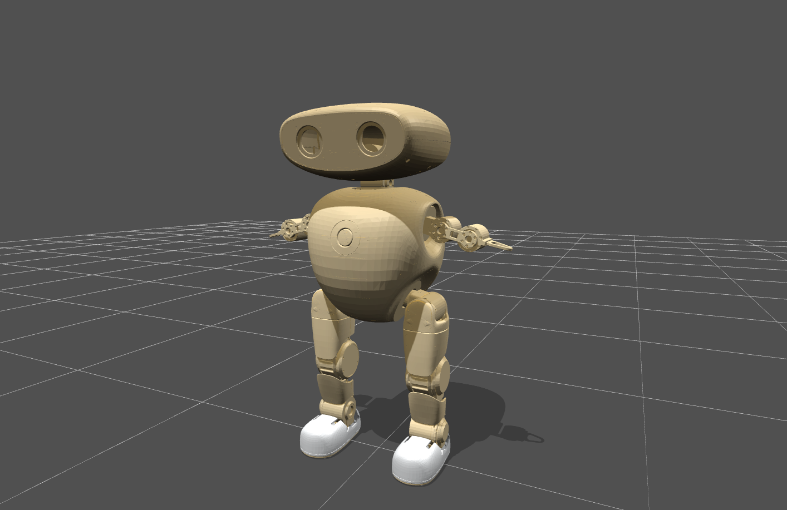

# 机器人URDF模型说明

## 文件列表
| 文件名 | 说明 |
|--------|------|
| [l0_v1_description.urdf](urdf/l0_v1_description.urdf) | 原始导出文件 |
| [l0_v1_simplified_description.urdf](urdf/l0_v1_simplified_description.urdf) | 对身体部位进行简化后的版本 |

## 注意事项
由于该版本mesh文件过于复杂，原始导出的模型文件(`l0_v1_description.urdf`)直接放入MuJoCo环境时，会出现**异常碰撞问题**，因为MuJoCo会对身体部位的STL格式碰撞网格自动进行凸包化处理，自动凸包化会导致非预期的碰撞检测.

`l0_v1_simplified_description.urdf`版本主要针对凸包带来的自碰撞问题修改部分碰撞体(包括身体、髋部、胳膊和脖子).

`l0_v1_description.urdf`原始版本放在Isaac中可能没有这个问题.

### 相关文档参考
- [MuJoCo官方文档 - Geom Distance](https://mujoco.readthedocs.io/en/stable/computation/index.html#geom-distance)
