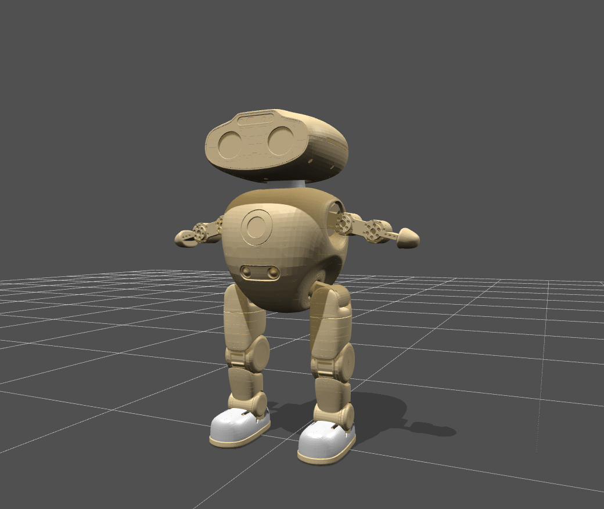

## 关节限位参数

| 关节 | effort (N·m) | velocity (rad/s) | armature (kg·m²) |
|------|-------------|-----------------|-----------------|
| left/right_hip_pitch_joint | 36 | 10.46 | 0.012 |
| left/right_hip_roll_joint | 27 | 3.768 | 0.032 |
| left/right_hip_yaw_joint | 12.5 | 12.56 | 0.0018 |
| left/right_knee_joint | 36 | 10.46 | 0.012 |
| left/right_ankle_pitch_joint | 14 | 27 | 0.001 |
| left/right_ankle_roll_joint | 12 | 21 | 0.00552096 |
| left/right_shoulder_pitch_joint | 5.5 | 10.46 | 0.001 |
| left/right_shoulder_roll_joint | 5.5 | 10.46 | 0.001 |
| left/right_elbow_roll_joint | 5.5 | 10.46 | 0.001 |
| neck_yaw/pitch/roll_joint | 12 | 21 | 0.00552096 |
