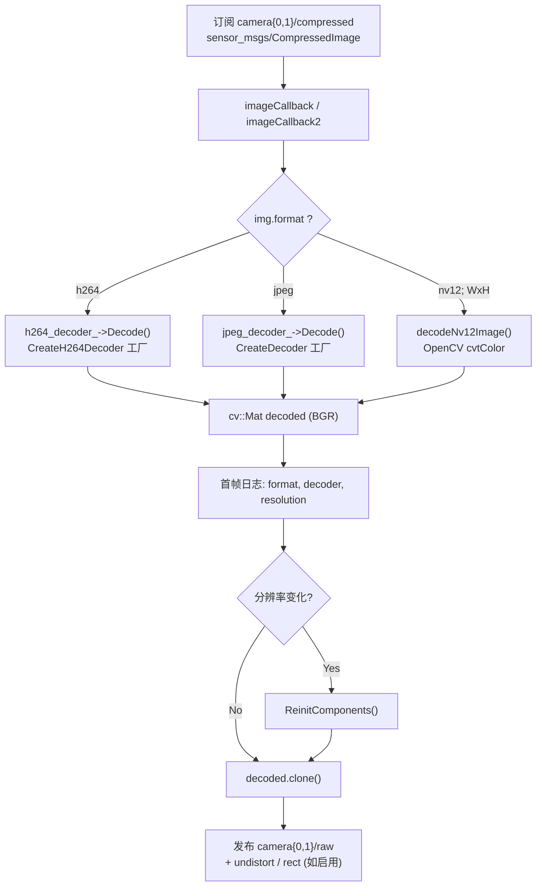
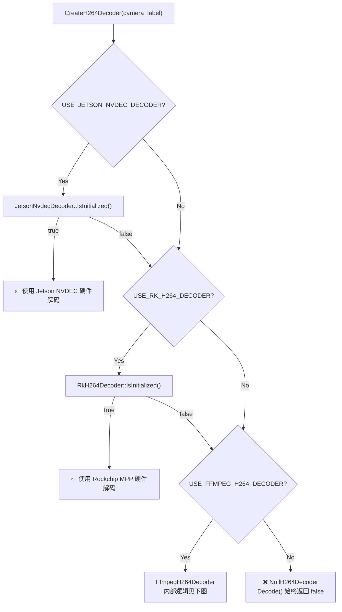
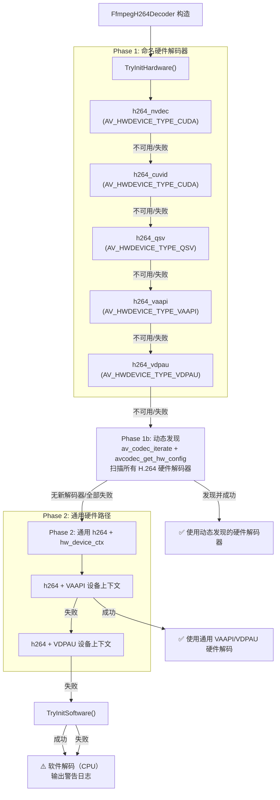
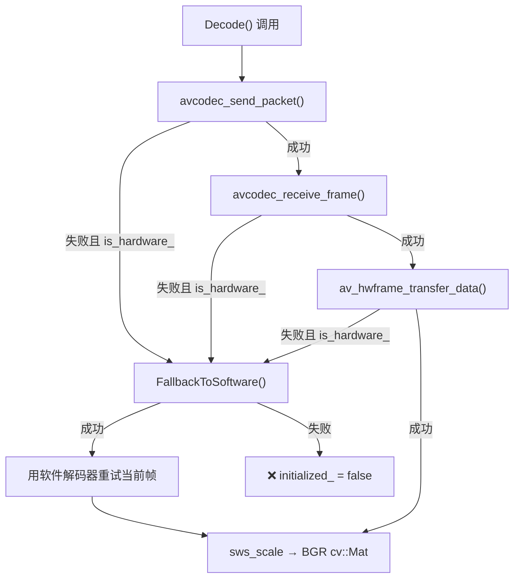
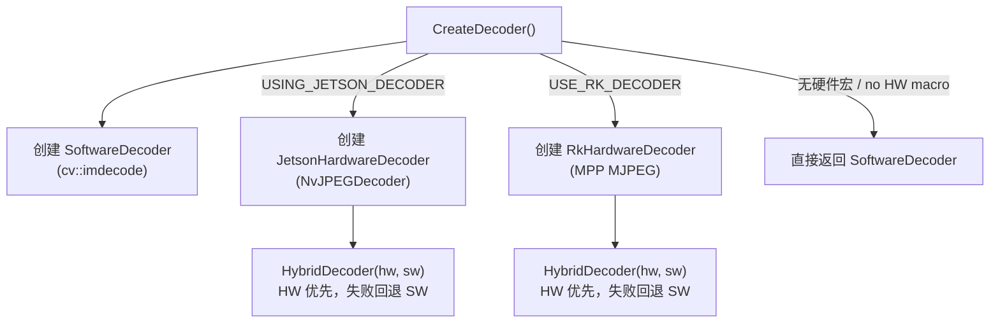
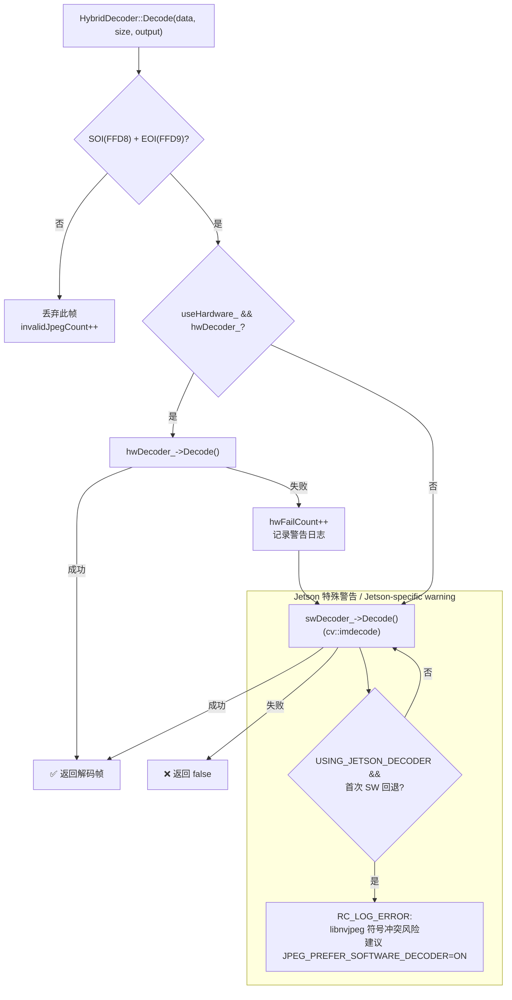

# 相机流解码 / Camera Stream Decoding

> [← 返回 README](../README.md)
> [硬件解码验证](hardware_decode.md) | [常见问题](troubleshooting.md)

---

## 目录 / Table of Contents

- [概述 / Overview](#概述--overview)
- [总体架构 / Overall Architecture](#总体架构--overall-architecture)
- [H.264 解码逻辑 / H.264 Decoding Logic](#h264-解码逻辑--h264-decoding-logic)
- [MJPEG 解码逻辑 / MJPEG Decoding Logic](#mjpeg-解码逻辑--mjpeg-decoding-logic)
- [NV12 原始流 / NV12 Raw Stream](#nv12-原始流--nv12-raw-stream)
- [前置条件 / Prerequisites](#前置条件--prerequisites)
- [调试方法 / Debugging](#调试方法--debugging)
- [屏幕录制建议 / Screen Recording Recommendation](#屏幕录制建议--screen-recording-recommendation)

---

## 概述 / Overview

`post_process_node` 接收 `sensor_msgs/CompressedImage` 格式的相机流，根据 `format` 字段分派到不同的解码后端，解码为 BGR `cv::Mat` 后发布到 `camera0/raw`、`camera1/raw` 话题供 RViz 显示。

The `post_process_node` receives camera streams as `sensor_msgs/CompressedImage` and dispatches to different decoder backends based on the `format` field, decoding into BGR `cv::Mat` frames published on the `camera0/raw` and `camera1/raw` topics for RViz display.

支持的流格式 / Supported stream formats:

| `format` 字段 / format field | 编码 / Encoding | 解码器 / Decoder | 有状态 / Stateful |
| --- | --- | --- | --- |
| `"h264"` | H.264 Annex-B 裸流 | `CreateH264Decoder` 工厂 | 是（需等待 IDR 关键帧） |
| `"jpeg"` | MJPEG / JPEG | `CreateDecoder`（JPEG）工厂 | 否（逐帧独立） |
| `"nv12; <w>x<h>"` | NV12 原始帧 | `decodeNv12Image`（OpenCV 色彩转换） | 否 |

两种工厂均在编译期和运行期自动选择最佳后端，覆盖 Jetson 嵌入式、Rockchip ARM、x86 PC 三类硬件平台。

Both factories select the optimal backend at compile time and runtime, covering Jetson embedded, Rockchip ARM, and x86 PC platforms.

---

## 总体架构 / Overall Architecture



### 编译期后端选择总览 / Compile-time Backend Overview

| 宏 / Macro | 探测条件 / Detection | H.264 后端 / H.264 Backend | JPEG 后端 / JPEG Backend |
| --- | --- | --- | --- |
| `USE_JETSON_NVDEC_DECODER` | `/etc/nv_tegra_release` + `NvVideoDecoder.h` + `libnvvideo` | Jetson NVDEC（直接调用 Multimedia API） | — |
| `USE_JETSON_NVDEC_DECODER` | 同上 + `NvJpegDecoder.h` + `libnvjpeg` | — | Jetson NvJpeg（HybridDecoder 包裹） |
| `USE_RK_H264_DECODER` | `rockchip/rk_mpi.h` + `librockchip_mpp.so` + `librga.so` | Rockchip MPP（直接调用 MPP 库） | — |
| `USE_RK_DECODER` | 同上（JPEG 路径独立探测） | — | Rockchip MPP MJPEG（HybridDecoder 包裹） |
| `USE_FFMPEG_H264_DECODER` | `pkg-config libavcodec libavutil libswscale` | FFmpeg（硬件加速 + 软件回退） | — |
| `USING_JETSON_DECODER` | `JPEG_PREFER_SOFTWARE_DECODER=OFF` + JetPack ≥ 6 + `NvJpegDecoder.h` | — | Jetson NvJpeg HW + SW fallback |
| （无宏 / none） | — | NullH264Decoder | OpenCV Software Decoder |

> **注 / Note**：H.264 和 JPEG 的后端选择相互独立。Jetson 平台可同时启用 NVDEC（H.264）+ NvJpeg（JPEG）+ FFmpeg（H.264 软件回退）。`JPEG_PREFER_SOFTWARE_DECODER=ON` 仅禁用 JPEG 硬件解码，不影响 H.264 NVDEC。
>
> H.264 and JPEG backend selection is independent. On Jetson, NVDEC (H.264) + NvJpeg (JPEG) + FFmpeg (H.264 SW fallback) can all be enabled simultaneously. `JPEG_PREFER_SOFTWARE_DECODER=ON` only disables JPEG hardware decoding, not H.264 NVDEC.

---

## H.264 解码逻辑 / H.264 Decoding Logic

### 运行期解码流程 / Runtime Decoding Flow



#### FfmpegH264Decoder 内部逻辑 / FfmpegH264Decoder Internal Logic



#### 运行期 HW→SW 回退 / Runtime HW→SW Fallback



### H.264 关键设计说明 / H.264 Key Design Notes

- **关键帧门控 / Keyframe Gating**：解码器启动或从错误恢复后进入 `waiting_for_keyframe_` 状态，丢弃所有非 IDR 帧，直到收到包含 IDR NAL（`nal_unit_type == 5`）的 Access Unit 才开始解码，避免参考帧缺失导致花屏。

- **单次失败即回退 / Single-failure Fallback**：当硬件解码器在运行期出现 `avcodec_send_packet`、`avcodec_receive_frame` 或 `av_hwframe_transfer_data` 任一失败时，立即销毁硬件解码器上下文，调用 `TryInitSoftware()` 重建软件解码器，并用同一帧数据重试解码。回退后进入 `waiting_for_keyframe_` 状态等待下一个 IDR。

- **动态发现 / Dynamic Discovery**：Phase 1b 通过 `av_codec_iterate` 遍历所有已注册的 H.264 解码器，使用 `avcodec_get_hw_config` 检查是否支持 `AV_CODEC_HW_CONFIG_METHOD_HW_DEVICE_CTX`，自动发现编译进 FFmpeg 但不在硬编码列表中的硬件后端（如 `h264_d3d12va`、`h264_vulkan` 或未来新增后端），用 `already_tried` 集合避免与 Phase 1 重复尝试。

- **设备指定 / Device Specification**：通过环境变量指定硬件设备节点，适用于多 GPU 或需要显式指定 render node 的场景。

---

## MJPEG 解码逻辑 / MJPEG Decoding Logic

MJPEG（Motion JPEG）每帧独立编码为 JPEG，无帧间参考，解码器无需维护状态。后端选择为纯编译期，由 CMake 探测平台后设置的宏决定。

MJPEG (Motion JPEG) encodes each frame independently as JPEG with no inter-frame references; the decoder is stateless. Backend selection is compile-time only, determined by macros set during CMake platform detection.

### 编译期后端选择 / Compile-time Backend Selection



### 运行期解码流程 / Runtime Decoding Flow



### JPEG 后端对比 / JPEG Backend Comparison

| 后端 / Backend | 宏 / Macro | 硬件 / Hardware | 软件回退 / SW Fallback | 备注 / Notes |
| --- | --- | --- | --- | --- |
| OpenCV Software | （无 / none） | — | — | `cv::imdecode`（libjpeg-turbo），所有平台可用 |
| Jetson Hybrid | `USING_JETSON_DECODER` | NvJPEGDecoder（`libnvjpeg`） | `cv::imdecode` | SW 回退可能因符号冲突崩溃，见 [troubleshooting §10](troubleshooting.md#10-jetson-硬解-fallback-到软解时崩溃libnvjpeg-与-libjpeg-turbo-符号冲突--crash-when-hw-decode-falls-back-to-sw-on-jetson-libnvjpeg-vs-libjpeg-turbo-symbol-clash) |
| Rockchip Hybrid | `USE_RK_DECODER` | MPP MJPEG + RGA 色彩转换 | `cv::imdecode` | RGA 硬件完成 NV12→BGR 转换，零 CPU 开销 |

### JPEG 关键设计说明 / JPEG Key Design Notes

- **逐帧无状态 / Stateless Decoding**：每帧 JPEG 独立解码，无需等待关键帧，解码失败仅丢弃当前帧，不影响后续帧。

- **SOI/EOI 校验 / SOI/EOI Validation**：`HybridDecoder` 在解码前检查 JPEG 帧首尾标志（`0xFFD8` / `0xFFD9`），不完整帧直接丢弃，避免硬件解码器崩溃。

- **Jetson 符号冲突 / Jetson Symbol Clash**：`libnvjpeg.so` 与 `libjpeg-turbo` 导出同名 `jpeg_*` 符号但 ABI 不兼容。当两者同时链接时，ELF 符号插序导致 `cv::imdecode` 实际调用 `libnvjpeg` 实现，在 `free()` 中 SIGSEGV。这是**编译期决策**——`JPEG_PREFER_SOFTWARE_DECODER=ON` 可完全避免链接 `libnvjpeg`，但无法在运行期切换。

- **Rockchip RGA 零拷贝 / Rockchip RGA Zero-Copy**：MPP 解码输出 NV12 到 DMA buffer，RGA 硬件将其转换为 BGR888 到另一个 cacheable DMA buffer。返回的 `cv::Mat` 包装该 buffer（零拷贝），调用方需在下一帧前 `clone()`。

---

## NV12 原始流 / NV12 Raw Stream

当设备直接输出 NV12 原始帧时（`format="nv12; <width>x<height>"`），不经过任何解码器，直接由 OpenCV `cv::cvtColor` 完成 YUV→BGR 色彩空间转换：

When the device outputs raw NV12 frames (`format="nv12; <width>x<height>"`), no decoder is invoked — OpenCV `cv::cvtColor` performs the YUV→BGR colour space conversion directly:

```cpp
cv::Mat nv12(h * 3 / 2, w, CV_8UC1, const_cast<uint8_t*>(data));
cv::cvtColor(nv12, decoded, cv::COLOR_YUV2BGR_NV12);
```

此路径无硬件加速，但 NV12→BGR 转换的 CPU 开销远低于 JPEG/H.264 解码，通常可忽略。

This path has no hardware acceleration, but the CPU cost of NV12→BGR conversion is negligible compared to JPEG/H.264 decoding.

---

## 前置条件 / Prerequisites

### 通用条件 / Common Requirements

| 条件 / Requirement | H.264 | JPEG | 说明 / Description |
| --- | --- | --- | --- |
| FFmpeg 开发库 / FFmpeg dev libraries | ✅ | — | `sudo apt-get install libavcodec-dev libavutil-dev libswscale-dev` |
| OpenCV / OpenCV | ✅ | ✅ | `cv::imdecode`（JPEG）、`sws_scale` + `cv::cvtColor`（H.264） |
| 码流格式 / Bitstream format | Annex-B（`0x00000001` 起始码） | JPEG（SOI `0xFFD8` + EOI `0xFFD9`） | `CompressedImage.format` 字段须设为 `"h264"` 或 `"jpeg"` |
| 关键帧 / Keyframe | H.264 须包含 IDR 帧 | — | 纯 P/B 帧流无法启动 H.264 解码；JPEG 逐帧独立无需关键帧 |

### NVIDIA GPU（NVDEC / CUVID） / NVIDIA GPU

| 条件 / Requirement | 说明 / Description |
| --- | --- |
| NVIDIA 驱动 / NVIDIA driver | ≥ 525（NVDEC 需要 `nvidia.ko` 内核模块加载） |
| FFmpeg 编译选项 / FFmpeg build flags | `--enable-nvdec`（或 `--enable-cuvid` + `--enable-ffnvcodec`） |
| 验证 / Verification | `ffmpeg -decoders \| grep h264_nvdec`；`nvidia-smi` 确认驱动加载 |
| 多 GPU 指定 / Multi-GPU | `export ODIN_CUDA_DEVICE=0`（CUDA 设备索引） |

### Intel GPU（QSV / VAAPI） / Intel GPU

| 条件 / Requirement | 说明 / Description |
| --- | --- |
| Intel 媒体驱动 / Intel media driver | `sudo apt-get install intel-media-va-driver-non-free`（6 代+）或 `i965-va-driver`（4–5 代） |
| VA-API 用户态库 / VA-API userspace | `sudo apt-get install libva2 libva-dev` |
| FFmpeg 编译选项 / FFmpeg build flags | `--enable-vaapi`（VAAPI 通用路径）；`--enable-libmfx` 或 `--enable-libvpl`（QSV 命名解码器） |
| 验证 / Verification | `vainfo` 须显示 `VAProfileH264High` 解码入口点 |
| render node 指定 / Render node | `export ODIN_VA_DEVICE=/dev/dri/renderD128` |

### AMD GPU（VAAPI） / AMD GPU

| 条件 / Requirement | 说明 / Description |
| --- | --- |
| Mesa VA 驱动 / Mesa VA driver | `sudo apt-get install mesa-va-drivers` |
| FFmpeg 编译选项 / FFmpeg build flags | `--enable-vaapi` |
| 验证 / Verification | `vainfo` 须显示 `VAProfileH264High` 解码入口点；AMD GPU 在 Linux 上通过 VAAPI 而非 AMF 暴露硬件解码 |
| render node 指定 / Render node | `export ODIN_VA_DEVICE=/dev/dri/renderD128` |

### Jetson 平台 / Jetson Platform

| 条件 / Requirement | H.264 | JPEG | 说明 / Description |
| --- | --- | --- | --- |
| JetPack 版本 / JetPack version | ≥ 5.0 | ≥ 6.0（R36+） | H.264 需 `NvVideoDecoder.h`；JPEG 需 `NvJpegDecoder.h`，R35 及以下因 ABI 冲突被 CMake 阻断 |
| 系统标记 / System marker | `/etc/nv_tegra_release` | 同 / same | — |
| 依赖库 / Libraries | `libnvvideo`、`libnvv4l2`、`libnvbufsurface` | `libnvjpeg`、`libnvbufsurface` | — |
| 优先级 / Priority | NVDEC 优先于 FFmpeg | NvJpeg 优先于 OpenCV | 若硬件初始化失败，自动回退到 FFmpeg/OpenCV |
| JPEG 软解安全 / JPEG safe SW | — | `JPEG_PREFER_SOFTWARE_DECODER=ON` | 禁用 `libnvjpeg` 链接，避免符号冲突崩溃 |

### Rockchip 平台 / Rockchip Platform

| 条件 / Requirement | H.264 | JPEG | 说明 / Description |
| --- | --- | --- | --- |
| MPP 库 / MPP library | `librockchip_mpp.so` + `rockchip/rk_mpi.h` | 同 / same | — |
| RGA 库 / RGA library | `librga.so` + `rga/im2d.h` | 同 / same | RGA 硬件完成 NV12→BGR 色彩转换 |
| 优先级 / Priority | MPP 优先于 FFmpeg | MPP 优先于 OpenCV | 若硬件初始化失败，自动回退 |

### 纯 CPU 服务器 / CPU-only Server

无 GPU 硬件时：
- **H.264**：FFmpeg 后端自动回退到软件 H.264 解码器（`avcodec_find_decoder(AV_CODEC_ID_H264)`）。启动时会输出醒目的警告日志提示 CPU 占用将显著升高。
- **JPEG**：直接使用 OpenCV `cv::imdecode`（libjpeg-turbo），无需任何额外配置。

When no GPU hardware is available:
- **H.264**: The FFmpeg backend automatically falls back to the software H.264 decoder. A prominent warning is logged at startup.
- **JPEG**: OpenCV `cv::imdecode` (libjpeg-turbo) is used directly, no additional configuration required.

---

## 调试方法 / Debugging

### 1. 确认编译期后端选择 / Verify Compile-time Backend Selection

CMake 配置阶段的输出会明确显示启用了哪些后端：

```bash
colcon build --packages-select <package_name> 2>&1 | grep -E "H.264|FFmpeg|NVDEC|Rockchip|JPEG"
```

预期输出示例（x86 PC + NVIDIA GPU）：

```
FFmpeg found — H.264 decoder enabled (hardware-accelerated with software fallback)
  avcodec: 58.134.100
│  H.264 Decoder: FFmpeg (software only)                       │
│  JPEG Decoder: OpenCV Software Decoder                        │
```

> **注意 / Note**：CMake 输出的 `FFmpeg (software only)` 仅表示编译期未启用 Jetson/RK 专用后端，不代表运行期无法使用硬件加速。运行期硬件解码器的选择由 `TryInitHardware()` 决定。

### 2. 确认运行期解码器类型 / Verify Runtime Decoder Type

驱动启动后，日志会输出实际使用的解码器后端：

```bash
# H.264 硬件解码成功时
[H264|camera0] [init] FFmpeg hardware decoder: NVDEC (h264_nvdec)
[H264|camera1] [init] FFmpeg hardware decoder: VAAPI (h264_vaapi)

# H.264 动态发现的硬件解码器
[H264|camera0] [init] FFmpeg hardware decoder (dynamic): h264_vulkan (device=<default>)

# H.264 通用 VAAPI 路径
[H264|camera0] [init] FFmpeg hardware decoder (generic): VAAPI (h264 + hw_device_ctx, device=/dev/dri/renderD128)

# H.264 软件回退（醒目警告块）
[H264|camera0] ============================================================
[H264|camera0]  FFmpeg H.264 SOFTWARE decoding in use (no HW backend found)
[H264|camera0]  CPU usage will be significantly higher.
[H264|camera0] ============================================================

# JPEG 解码器
[P080400114] JPEG decoder: OpenCV Software Decoder
# 或
[P080400114] JPEG decoder: Hybrid(HW=NvJpegDecoder Hardware, SW=OpenCV Software Decoder)

# 首帧日志（含分辨率）
[P080400114] [H264|camera0] [first-frame] stream format=h264, decoder=FfmpegH264Decoder (VAAPI-generic hardware), resolution=640x544
```

### 3. 确认 FFmpeg 可用的硬件解码器 / List Available HW Decoders

```bash
# 列出所有 H.264 解码器
ffmpeg -decoders 2>/dev/null | grep h264

# 检查特定硬件解码器是否编译进 FFmpeg
ffmpeg -decoders 2>/dev/null | grep -E "h264_nvdec|h264_cuvid|h264_qsv|h264_vaapi|h264_vdpau"
```

### 4. 确认 VAAPI 设备可用性 / Verify VAAPI Device

```bash
# 安装 vainfo 工具
sudo apt-get install vainfo

# 查看硬件解码能力
vainfo

# 预期输出（Intel iGPU 示例）：
# VAProfileH264High : VAEntrypointVLD
```

若 `vainfo` 报错 `libva not initialized` 或无 H.264 入口点，说明 VAAPI 驱动未正确安装或 GPU 不支持硬件 H.264 解码。

### 5. 确认 GPU 驱动加载 / Verify GPU Driver

```bash
# NVIDIA
nvidia-smi
ls /dev/nvidia*  # 设备节点应存在

# Intel / AMD (VAAPI)
ls /dev/dri/renderD*  # render node 应存在
# 查看哪个 render node 绑定到哪个 GPU
ls -l /dev/dri/by-path/

# VDPAU (NVIDIA 旧驱动 / AMD 旧驱动)
vdpauinfo
```

### 6. 运行期硬件回退检测 / Detect Runtime HW→SW Fallback

当硬件解码器在运行期失败时，日志会输出回退信息：

```bash
# 监控回退日志
# 过滤关键词：fallback
journalctl -u <ros_node_service> -f | grep -i fallback

# 或直接观察终端输出
# 预期日志：
# [H264|camera0] [fallback] HW decoder 'NVDEC' failed at runtime, switching to software
# [H264|camera0] [fallback] software decoder ready, waiting for next IDR
```

### 7. CPU 占用对比 / CPU Usage Comparison

```bash
htop -p $(pgrep post_process_node)
```

| 模式 / Mode | 1080p H.264 @30fps 单核占用 / Single-core load |
| --- | --- |
| 软解 / Software | ~60–100% |
| 硬解 / Hardware | ~5–15%（仅余 GPU→CPU 帧传输 + 色彩空间转换 + memcpy） |

### 8. 解码错误日志 / Decode Error Logs

解码过程中的错误会输出到 `stderr`，常见错误及含义：

| 日志 / Log | 含义 / Meaning |
| --- | --- |
| `avcodec_send_packet error: <code>` | 发送数据包失败，可能是码流损坏或硬件解码器异常 |
| `avcodec_receive_frame error: <code>` | 接收解码帧失败，可能是参考帧丢失或硬件资源不足 |
| `av_hwframe_transfer_data error: <code>` | GPU→CPU 帧传输失败，可能是显存不足或驱动异常 |
| `IDR received, leaving keyframe-wait state` | 收到关键帧，解码恢复正常（信息日志，非错误） |
| `Incomplete JPEG (no SOI/EOI), frame dropped` | JPEG 帧不完整，被 HybridDecoder 丢弃 |
| `HW decode failed on valid JPEG, falling back to SW` | JPEG 硬件解码失败，回退到 OpenCV 软解码 |

### 9. 环境变量速查 / Environment Variables

| 环境变量 / Env var | 作用 / Purpose | 示例 / Example |
| --- | --- | --- |
| `ODIN_CUDA_DEVICE` | 指定 CUDA 设备（多 GPU 场景） | `export ODIN_CUDA_DEVICE=0` |
| `ODIN_VA_DEVICE` | 指定 VAAPI render node | `export ODIN_VA_DEVICE=/dev/dri/renderD128` |
| `ODIN_VDPAU_DEVICE` | 指定 VDPAU 设备 | `export ODIN_VDPAU_DEVICE=/dev/dri/card0` |
| `ODIN_NVDEC_STATS` | Jetson NVDEC 流水线统计 | `export ODIN_NVDEC_STATS=1` |
| `ODIN_NVDEC_MAX_LATENCY_FRAMES` | Jetson NVDEC 解码帧 FIFO 积压上限 | `export ODIN_NVDEC_MAX_LATENCY_FRAMES=2` |
| `ODIN_NVDEC_KEEP_DPB` | Jetson NVDEC 保留 DPB（默认禁用） | `export ODIN_NVDEC_KEEP_DPB=1` |
| `ODIN_H264_FORCE_SW` | 强制 H.264 软件解码，跳过所有硬件后端（HW/SW 对比测试用） | `export ODIN_H264_FORCE_SW=1` |
| `ODIN_DISABLE_LIBYUV` | 禁用 libyuv 快速色彩转换，回退 libswscale/OpenCV（需编译时启用 libyuv） | `export ODIN_DISABLE_LIBYUV=1` |

---

## 屏幕录制建议 / Screen Recording Recommendation

### 问题 / Problem

使用者在 RViz 运行时录制屏幕以保存可视化结果。Linux 默认的屏幕录制工具（**GNOME 自带录屏（PrintScreen 键触发、`gjs` 进程）**、OBS 软件编码模式、SimpleScreenRecorder 等）使用 **软件编码**（CPU `libx264`/`libvpx`），在录制高分辨率 RViz 画面的同时会与 `post_process_node` 的解码线程争夺 CPU 资源，导致：

- RViz 显示丢帧、马赛克
- 录制出的视频本身也丢帧或出现马赛克
- 整体系统响应迟缓

When recording the screen during RViz playback, Linux's default screen recorders (**GNOME built-in recorder (triggered by PrintScreen, `gjs` process)**, OBS in software encoding mode, SimpleScreenRecorder, etc.) use **software encoding** (CPU `libx264`/`libvpx`). This competes with `post_process_node`'s decode threads for CPU resources, causing RViz frame drops and mosaic artifacts — both in the live display and in the recorded video.

### 推荐方案 / Recommended Solution

使用 **GPU Screen Recorder**（<https://git.dec05eba.com/GPUScreenRecorder>），它通过 GPU 硬件编码（NVENC/VAAPI/QSV）直接在显卡上完成 H.264/HEVC 编码，几乎不占用 CPU 资源：

Use **GPU Screen Recorder** (<https://git.dec05eba.com/GPUScreenRecorder>), which performs H.264/HEVC encoding directly on the GPU via hardware encoders (NVENC/VAAPI/QSV), leaving CPU resources free for decoding and rendering.

#### 安装 / Installation

```bash
# Ubuntu / Debian（推荐 Flatpak 安装）
flatpak install flathub com.dec05eba.GPUScreenRecorder

# 或从 PPA 安装（Ubuntu 22.04+）
sudo add-apt-repository ppa:dec05eba/gpu-screen-recorder
sudo apt update
sudo apt install gpu-screen-recorder
```

#### 使用 / Usage

```bash
# 图形界面启动
flatpak run com.dec05eba.GPUScreenRecorder
# 或（PPA 安装）
gpu-screen-recorder-gtk

# 命令行模式：录制整个屏幕到文件，60fps，NVENC H.264
gpu-screen-recorder -w screen -c mp4 -f 60 -a h264
```

#### 各平台硬件编码后端 / Hardware Encoding Backend by Platform

| 平台 / Platform | 编码后端 / Encoding Backend | 前置条件 / Requirement |
| --- | --- | --- |
| NVIDIA GPU | NVENC（`h264_nvenc` / `hevc_nvenc`） | NVIDIA 驱动 ≥ 525 |
| Intel iGPU | QSV / VAAPI（`h264_qsv` / `h264_vaapi`） | `intel-media-va-driver`，`vainfo` 可用 |
| AMD GPU | VAAPI（`h264_vaapi`） | `mesa-va-drivers`，`vainfo` 可用 |
| Jetson | NVENC（Jetson 硬件编码器） | JetPack ≥ 5.0 |

#### 效果对比 / Performance Comparison

| 录制方式 / Method | CPU 额外占用 / Extra CPU Load | RViz 丢帧 / RViz Frame Drops | 录制质量 / Recording Quality |
| --- | --- | --- | --- |
| 软件编码（GNOME 自带录屏 / OBS x264，`gjs`） | **实测 412.6%**（≈4 核饱和） | 明显丢帧、马赛克 | 丢帧、马赛克 |
| GPU Screen Recorder（硬件编码，`gpu-screen-reco`） | **实测 10.3%**（不足 1/8 核） | 无明显影响 | 流畅、无丢帧 |

> **注 / Note**：两组数据均为本机实测（`top`，录制同时运行 ROS Driver + RViz）。软件编码（GNOME 自带录屏）时 `gjs` 进程独占 412.6% CPU，整机 load average 高达 4.27，`odin_ros_driver`（42.2%）、`post_process_node`（28.6%）、`rviz2`（17.6%）被明显挤压；切换为 GPU Screen Recorder 后 `gpu-screen-reco` 进程仅 10.3% CPU（编码在 GPU 硬件上完成），整机 load average 降至 1.33，`odin_ros_driver`（52.3%）与 `post_process_node`（33.8%）获得更多 CPU 余量，RViz 渲染恢复正常。
>
> Both figures are measured on the same machine (`top`, with ROS Driver + RViz running concurrently). With software encoding (GNOME built-in recorder), the `gjs` process alone consumes 412.6% CPU, pushing load average to 4.27 and starving `odin_ros_driver` (42.2%), `post_process_node` (28.6%), and `rviz2` (17.6%). With GPU Screen Recorder, the `gpu-screen-reco` process needs only 10.3% CPU (encoding happens on GPU hardware), load average drops to 1.33, and `odin_ros_driver` (52.3%) and `post_process_node` (33.8%) gain more CPU headroom — RViz rendering returns to normal.

> **提示 / Tip**：如果 GPU Screen Recorder 不可用，OBS Studio 也可配置为硬件编码模式（Settings → Output → Encoder → NVIDIA NVENC H.264 / Intel QSV H.264 / AMD HW H.264），同样可大幅降低 CPU 占用。
>
> If GPU Screen Recorder is unavailable, OBS Studio can also be configured for hardware encoding (Settings → Output → Encoder → NVIDIA NVENC H.264 / Intel QSV H.264 / AMD HW H.264), which similarly reduces CPU usage.
